**Paper 1 of 5, Kampala drainage programme.** Merges earlier drafts A (*Rainfall or drainage?*) and 6 (*Design-basis drift*).
**Target journals:** *Journal of Flood Risk Management*; *Natural Hazards and Earth System Sciences*; *Landscape and Urban Planning*.

# Abstract

Kampala's recurrent floods are usually blamed on heavier rain. We test that claim city-wide with open data: 6,914 drainage-channel stretches (469 km), OpenStreetMap drains, culverts and dump sites, 537,000 building footprints, JRC GHSL built-up and population 1975–2030, a 30 m terrain model, 45 years of satellite rainfall, and an open catalogue of dated floods (2007–2026).

1. **The storms have not intensified.** The wettest day of the year changed by −1.0 mm per decade (p = 0.24) and the wettest three days by +0.7 mm per decade (p = 0.46), although annual totals rose about 15%.
2. **Floods come on ordinary rain.** On the median dated flood day, satellite rain ranked only at the 74th percentile of wet days, and on 7 of 18 days it was below 5 mm. Flood days are predicted by short, intense bursts (peak-hour rain, p = 0.015), not daily totals. A test of whether the rain needed to flood has fallen (2017–2026) finds no detectable change but has little power.
3. **What separates the hotspots is how the city built around its drains.** An equal-weight index of six drainage pressures separates channels at 45 reported hotspots from the rest (AUC 0.73, 95% CI 0.58–0.89). The strongest pressures are homes on low ground, buildings in the 15 m channel reserve, culverts and bridges, and lost wetland.
4. **The channels have fallen behind the flows they now receive.** Sized for the 1990 10-year flow, channels now receive a median 17% more in that storm. Half of all channel length is overloaded by more than 20%, rising to 80–91% with 2030 land cover and 2041–70 rainfall. A 30% silted channel carries 2.7 times less than its design flow, a larger loss than 30 years of paving.
5. **The next hotspots can be seen coming.** A score built only from 1975–2000 change predicts where valley floors were built over in 2000–2020 (AUC 0.79). Design-basis drift is concentrated on the same northern and eastern fringe.

Kampala's flood problem is made on the ground: encroachment, constrictions, lost wetland, siltation and channels sized for a smaller city. Those are the levers planners control.

# 1. Introduction

- **The debate.** Kampala floods most rainy seasons: 26 March 2025 (seven deaths), 31 October 2025 (three deaths in the Nakivubo channel), 10–11 October 2026 (Lubigi, Kinawataka). Each time, public debate swings between "climate change" and "encroachment and garbage". KCCA lists 68–69 flood hotspots. The 2017 update of the Drainage Master Plan is only partly funded, and about 73% of Kampala–Wakiso wetland was lost in 1986–2016 (Kabiri et al. 2022).
- **What is known.**
  - Scenario models of single catchments (Upper Lubigi) show that sediment and waste in culverts can raise flood volumes by up to 105% for frequent storms (Olsson et al. 2025).
  - City-scale assessments describe a mix of climatic and urban drivers (Lwasa 2010; Douglas et al. 2008; Arinabo 2024).
- **The gap.** There is no city-wide, channel-level, reproducible test of the two explanations, no estimate of how far the channels have fallen behind their catchments, and no forward-looking map of where new hotspots will form.
- **Contributions:**
  1. a test of the rainfall explanation, combining 45 years of satellite rain with an open catalogue of dated floods;
  2. an open channel-level inventory of drainage pressures, validated against reported hotspots;
  3. a city-wide screening of design-basis drift under paving, siltation and climate change;
  4. a temporally validated early-warning score for emerging hotspots.

# 2. Study area and data

## 2.1 The case: Kampala's hills, valleys and channels

Kampala is built on a cluster of flat-topped hills (about 1,190–1,300 m) separated by broad valley floors that fall towards Lake Victoria (1,134 m). Rain is bimodal, with long rains in March–May and short rains in September–November, and most floods follow convective storms lasting under two hours. The study box (32.45–32.72° E, 0.20–0.42° N; 3.6 million residents in 2020) covers the whole of Kampala Capital City (195 km² under KCCA) and the most built-up parts of Wakiso district around it (Figure 1).

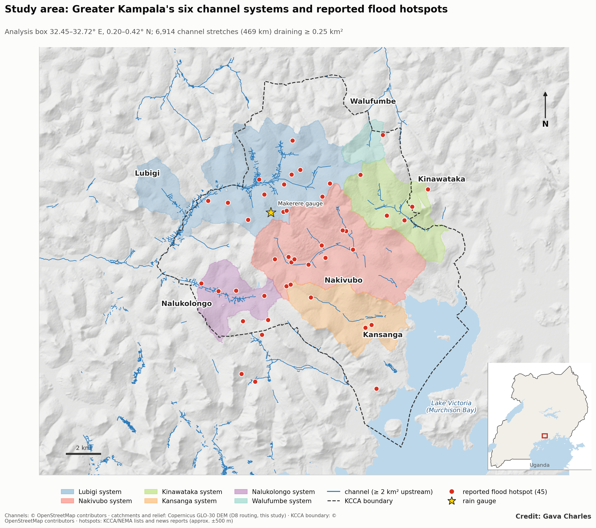{width=100%}

Six channel systems drain the city:
- **Lubigi** (46 km², north-west) runs from Bwaise and Kalerwe through the Lubigi wetland to the Mayanja river, not the lake;
- **Nakivubo** (38 km²) drains the city centre, Kisenyi, Katwe and Industrial Area to Murchison Bay at Luzira;
- **Kinawataka** (17 km², east) drains Ntinda, Kyambogo and Banda to the bay through the Kinawataka–Namanve wetland;
- **Kansanga** (17 km², south-east) drains Kabalagala, Kansanga and Ggaba;
- **Nalukolongo** (11 km², south-west) drains Ndeeba, Kibuye and Natete;
- **Walufumbe** (4 km², north) drains Kyebando and Kisaasi.

Most channels were dug or lined in phases across the valley floors that were papyrus swamp until the 1970s–80s. KCCA maintains the primary channels; tertiary drains are largely the responsibility of residents, and much of the fringe lies outside KCCA's mandate in Wakiso. Of the 45 reported hotspots (KCCA/NEMA lists and news), 39 lie inside the KCCA boundary, concentrated on the Lubigi, Nakivubo and Kinawataka systems. The city's only long-running rain gauge in the public record is at Makerere University.

## 2.2 Data

| Layer | Source | Use |
|---|---|---|
| Channels, culverts, bridges, dump sites, markets | OpenStreetMap (16,575 waterways; 3,135 culverts; 1,553 waste points) | Network, constrictions, waste pressure |
| Buildings | Microsoft Global ML Building Footprints (537,408) | Reserve encroachment; homes on low ground |
| Built-up and population, 1975–2030 | JRC GHSL R2023A | Paving, valley-floor building, exposure |
| Terrain | Copernicus GLO-30 DEM | D8 routing, upstream area, HAND |
| Land cover | ESA WorldCover 2021; Impact Observatory 2017–2023 | Wetland remaining |
| Rainfall | CHIRPS v2.0 (daily, 1981–2025); NASA POWER hourly (MERRA-2, 2001–2026); gauge-corrected IDF (Fiddes et al. 1974) | Trends, flood-day rain, design storms |
| Climate projections | CMIP6 SSP2-4.5 and SSP5-8.5, 2041–70 | Design-storm uplift |
| Flood record | 45 hotspots (KCCA/NEMA lists, news); flood catalogue 2007–2026 (Gava 2026) | Validation; threshold test |

# 3. Methods

The study tests two explanations side by side, applying three tests to each (Figure 2).

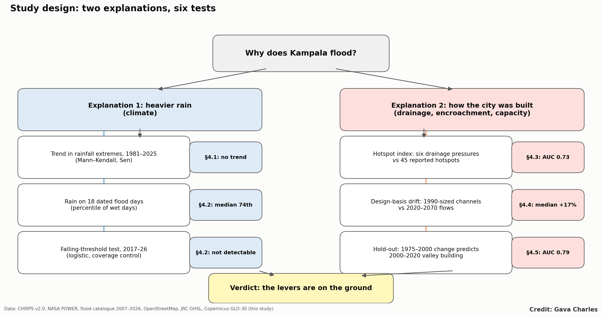{width=100%}

**3.1 Channel inventory.** Waterways were cut into segments of 200 m or less, and the 6,914 draining at least 0.25 km² were analysed. For each: upstream area (D8), upstream built-up share in 1990 and 2020, a runoff load (area × C, C = 0.25 + 0.65 × impervious share), valley-floor built share (HAND < 3 m within 250 m), wetland within 500 m, buildings within 15 m (the channel reserve), buildings on low ground (HAND < 2 m within 150 m), dump sites within 100 m, markets within 300 m, and culverts and bridges.

**3.2 Rainfall and the falling-threshold test.** Annual indices for the Greater Kampala mean (totals, days ≥ 20 mm, wettest day, wettest three days) were tested with Sen's slope and Mann–Kendall. For every day 2017–2026, a logistic model relates whether a flood was reported to same-day and three-day rain (CHIRPS; peak-hour POWER rain as sensitivity), a linear time trend, and monthly news coverage (GDELT volume), with HAC errors (7 lags). A trend odds ratio above 1 at fixed rain would mean the same rain floods more often.

**3.3 Hotspot index.** Each pressure is converted to a percentile; the index is the equal-weight mean of six present-day pressures. Equal weights were chosen because weights fitted to the hotspots did not transfer across space (spatial cross-validated AUC 0.52–0.59). Hotspots were matched to segments within 400 m; AUC uncertainty comes from a 2 km block bootstrap.

**3.4 Design-basis drift.** Peak flows use the rational method, Q_T = 0.278 · C · i_T(t_c) · A · ARF, with Kirpich time of concentration, Hack flow length and an areal reduction factor. Each stretch is sized to carry the 10-year flow under 1990 land cover (rectangular, width = 3 × depth, n = 0.025). The overload ratio is the scenario 10-year flow divided by that capacity, under 2020 land, 2030 land, 2030 land with 2041–70 SSP2-4.5 or SSP5-8.5 rainfall, and 2020 land with 30% siltation (depth −30%, n = 0.035). Absolute capacities are hypothetical; the ratio measures change relative to a consistent design rule.

**3.5 Emerging risk and temporal hold-out.** An emerging-risk score combines upstream runoff growth and valley-floor building. To test it, the score was built from 1975–2000 data only and asked to identify the top quartile of segments by valley-floor building added in 2000–2020.

# 4. Results

## 4.1 The storms have not intensified

| Index (Greater Kampala, CHIRPS) | 1981–95 mean | 2011–25 mean | Sen slope / decade | p |
|---|---|---|---|---|
| Annual rain (mm) | 1,223 | 1,400 | +46.8 | 0.05 |
| Days ≥ 20 mm | 4.4 | 6.1 | +0.27 | 0.41 |
| Wettest day (mm) | 33.0 | 30.0 | −1.0 | 0.24 |
| Wettest 3 days (mm) | 52.3 | 54.7 | +0.7 | 0.46 |

Nights warmed by 0.40 °C per decade (p < 0.001), but the rainfall extremes that drive flash floods show no trend.

## 4.2 Floods come on ordinary rain and short bursts

Across 18 dated floods in the catalogue (2007–2026), the median flood day ranked at the 74th percentile of wet days, and 7 had less than 5 mm of satellite rain (Figure 3, Figure 4). Satellite rain smooths local storms (29–31 October 2025: 63 mm at the Makerere gauge, 21 mm in CHIRPS), so some events are under-measured. Even so, Kampala floods on rain a working drainage system should carry.

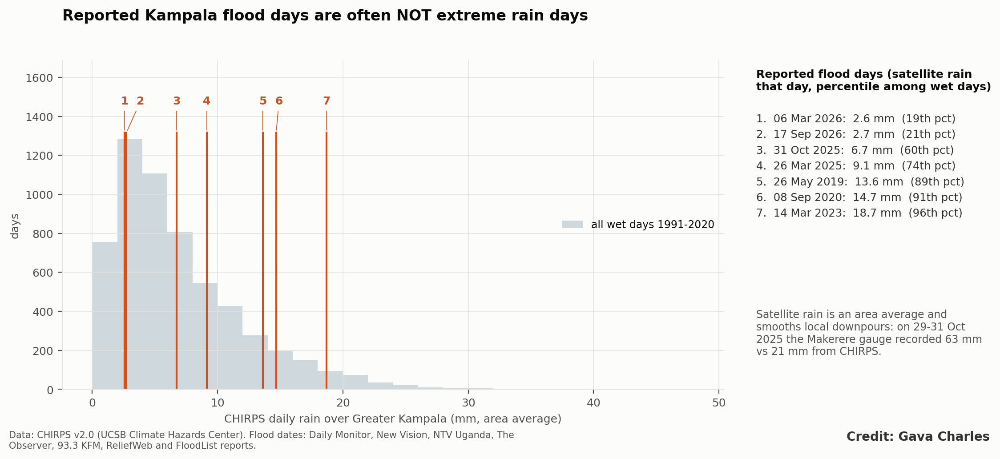{width=100%}

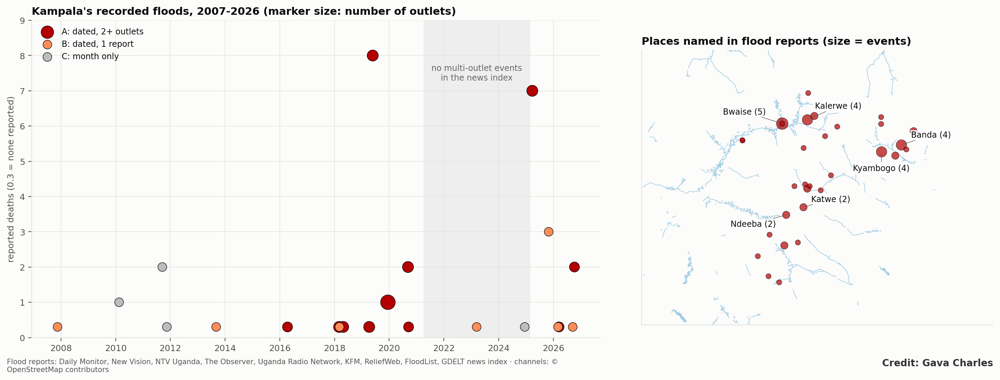{width=100%}

| Model (wet days, n = 1,947; 20 flood days) | Odds of a flood per year, same rain (95% CI) | p |
|---|---|---|
| Daily rain + coverage control | 1.09 (0.79–1.51) | 0.59 |
| Daily rain, no coverage control | 1.05 (0.83–1.31) | 0.70 |
| Peak-hour rain + coverage control | 1.08 (0.78–1.51) | 0.63 |

No change in the flood-triggering rain is detectable, but the test is underpowered: the intervals include both no change and a 50% yearly rise in flood odds. One result is robust: peak-hour rain strongly predicts a reported flood (odds ratio 2.8 per log-unit, p = 0.015), while daily satellite rain does not (1.78, p = 0.22). Kampala's floods are driven by cloudbursts lasting minutes to hours.

## 4.3 What sets the hotspots apart

The equal-weight index separates hotspot channels from others (AUC 0.73, 95% CI 0.58–0.89; 0.63 within the denser half of channels, so it does more than flag density).

| Pressure | Hotspots (median percentile) | Other channels | AUC alone |
|---|---|---|---|
| Buildings on low ground ≤ 150 m | 75 | 36 | 0.65 |
| Buildings in the 15 m reserve | 73 | 36 | 0.64 |
| Culverts and bridges | 68 | 33 | 0.60 |
| Little wetland left | 66 | 46 | 0.68 |
| Dump sites and markets | 41 | 41 | 0.61 |
| Runoff load (area × paving) | 39 | 50 | 0.50 |
| Runoff growth since 1990 | 21 | 55 | 0.23 |

Of 469 km of flowing channel, 138 km rank high now and are still worsening, 44 km rank high but are stable, and 100 km show rising risk that is not yet high (Figure 5, Figure 6, Figure S1).

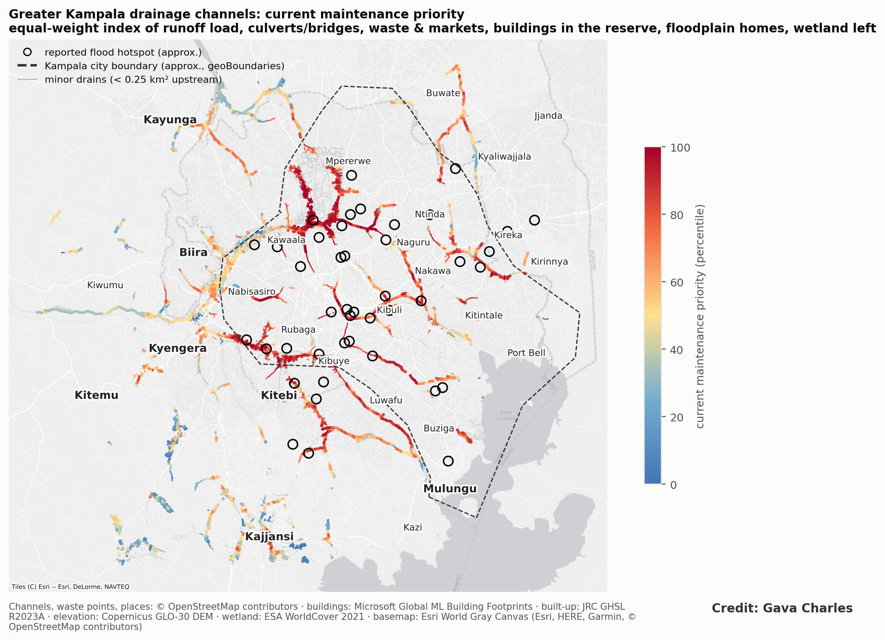{width=100%}

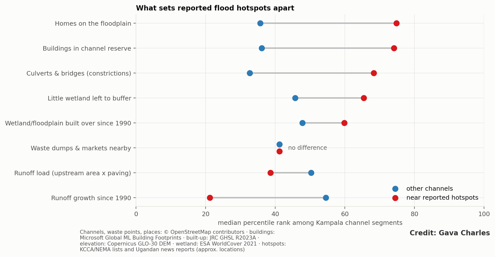{width=100%}

## 4.4 The channels have fallen behind their catchments

| Scenario | Median overload | Channel length overloaded > 20% | > 50% |
|---|---|---|---|
| 2020 land | 1.17 | 230 km (49%) | 55 km |
| 2030 land | 1.20 | 254 km (54%) | 57 km |
| + 2041–70 SSP2-4.5 | 1.31 | 374 km (80%) | 90 km |
| + 2041–70 SSP5-8.5 | 1.36 | 424 km (91%) | 120 km |
| 2020 land, 30% silted | 2.73 | 468 km (100%) | 468 km |

Today 84 km of channel (18%) can no longer carry a 2-year storm, and only 6 km still carries the 10-year storm it was sized for (Figure 7). Two findings shape the interpretation:
- **Siltation dwarfs drift.** A 30% silted channel carries less than half of a clean one, a larger loss than three decades of paving. Paper 4 shows that this makes silt the dominant cause of road flooding.
- **Drift is not where today's hotspots are.** The overload ratio is strongly negatively associated with reported hotspots (AUC 0.16), because those lie in the old city, paved before 1990. There, channels fail through encroachment, constrictions, siltation and sizing that predates 1990. Drift is greatest on the fringe: Walufumbe and Kinawataka (median 1.21; 64–81% of length overloaded), the Lubigi headwaters and the Nasere and Mayanja–Waswa channels (1.5–1.7) (Figure 8).

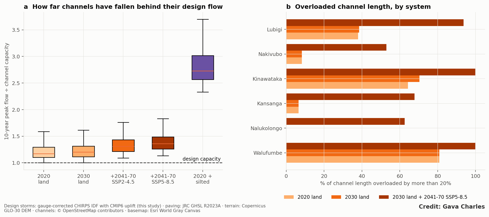{width=100%}

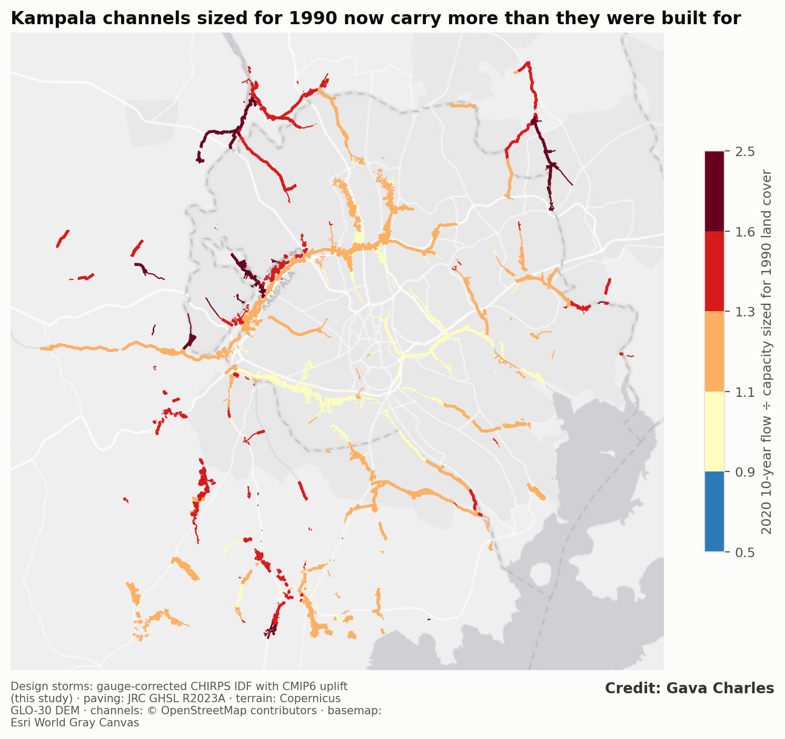{width=100%}

## 4.5 The next hotspots can be seen coming

The early-change score predicts later valley-floor building (AUC 0.79, 95% CI 0.71–0.87; naive "built areas grow" rule 0.58). Channels in its top quintile gained 6.5 percentage points of built valley floor in 2000–2020, against 1.6 in the bottom quintile (Figure 9). Run today, it points to the northern and eastern fringe (Kira, Nansana, Namugongo) and the Kinawataka and Kansanga headwaters (Figure 10), the same areas where design-basis drift is greatest. Two independent signals, building on the valley floors and channels outgrown by their catchments, converge on where Kampala's next hotspots are forming.

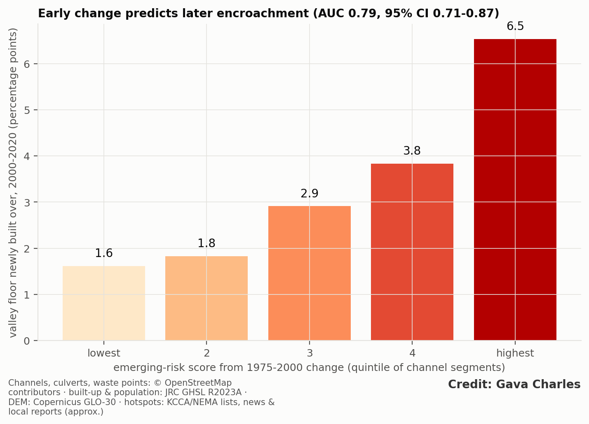{width=100%}

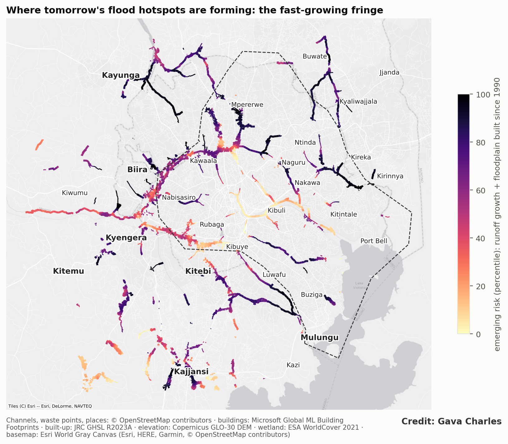{width=100%}

## 4.6 Pathways open data cannot settle

- **Waste and culverts.** Culverts with a dump site within 250 m upstream were more often near a hotspot (19% vs 12%), but the effect disappears once paving, catchment size and density are controlled (odds ratio 0.87 per SD, 95% CI 0.51–1.59). Dumping clusters where the city is dense, so open data cannot isolate its effect; field inspection is needed.
- **Satellites and flash floods.** A Sentinel-1 pass 13 hours after the 11 October 2026 storm showed almost no standing water (0.18% of the area newly wet). Kampala's floods drain faster than any satellite revisit.

# 5. Discussion

- **Why the two explanations are so often confused.** Floods are reported when it rains, so rain is always present at the scene. But the comparison that matters is between days with similar rain and different outcomes, and between places with the same rain and different outcomes. On both comparisons, the drainage explanation wins: similar storms produce floods only where the drains have been squeezed, silted or built over, and floods follow ordinary rain more often than extreme rain.
- **What heavier rain would have looked like.** If climate were the driver, we would expect rising annual maxima, flood days drifting towards more extreme rain, and hotspots spread evenly across systems with similar paving. None of these appears. The one robust rainfall signal, that short bursts matter more than daily totals, points to a drainage system with little spare capacity, not to a changing climate.

- **The levers are on the ground.** The pressures that separate hotspots (building in the reserve and on the floodplain, constrictions, lost wetland) and the capacity losses (siltation, channels sized for 1990) are planning, enforcement and maintenance variables, not climate variables.
- **Two problems, two responses.**
  - *Old city:* capacity lost to siltation and encroachment. Desilting, culvert clearing and reserve enforcement give the fastest gains (Paper 4 prices them).
  - *Fringe:* channels being overtaken by paving now and heavier storms after 2040. Respond with on-site detention for new development, future-conditions design standards (projected land cover plus a climate uplift: under SSP5-8.5, flows 36% above 1990 conditions are the median by 2041–70), and protection of the remaining valley-floor storage (Paper 2).
- **Prevention is possible.** The hold-out shows encroachment can be anticipated 20 years ahead from open data. Development control on emerging-risk channels now is cheaper than retrofitting.
- **Monitoring.** Satellites track slow change but cannot see flash floods or narrow channels. Kampala needs sub-hourly rain gauges, water-level sensors at key culverts and a systematic flood log.
- **Limitations:**
  - hotspot positions are approximate and the list is centre-biased;
  - OSM completeness varies, and channel geometry is rule-based, so drift is screened as a ratio, not measured capacity;
  - the rational method overestimates peaks for larger catchments (partly offset by the ARF);
  - satellite rainfall under-measures local storms;
  - the dated flood record is short and has a reporting gap in 2021–24.

# 6. Conclusion

Kampala's floods are not explained by heavier rain: extremes have not increased since 1981, and floods come on ordinary rain and short bursts. What sets the hotspots apart is how the city has built around its drains, and its channels have fallen behind the flows their paved catchments now send, by a median 17% since 1990 and by up to 36% once 2041–70 rainfall is added. Silt removes more capacity than all of that paving. The next hotspots are forming on the fringe, where both encroachment and drift are growing, and they can be seen in open data today.

# Data and code availability

Code: `src/kd_network.py`, `kd_rain.py`, `kd_threshold.py`, `kd_hydraulics.py`, `kd_capacity.py`, `kd_maps.py`. Flood catalogue: `results/kampala_flood_catalogue_2007_2026.csv` (data paper). Dashboard: Kampala Drain Watch (gavacharles.github.io/kampala-drain-watch).

# Figures

Figures are embedded in the text.

# Supplementary figures

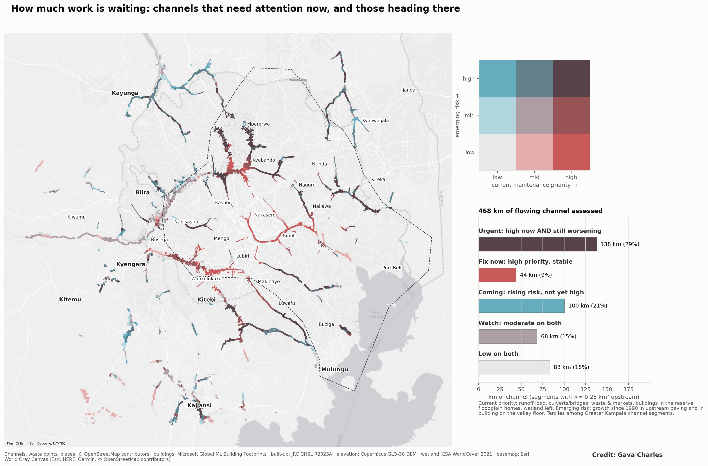{width=100%}

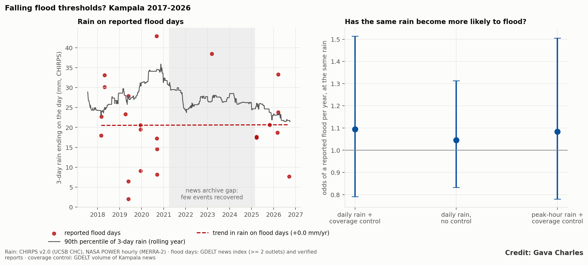{width=100%}

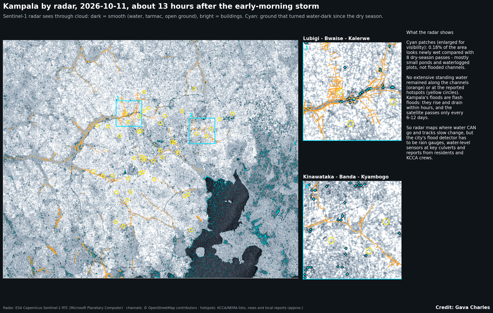{width=100%}

# References

Items marked † were found through search, or are grey literature not yet opened; verify them before submission.

1. Arinabo, D. (2024). Understanding the evolving nature of urban flood risks in sub-Saharan Africa: the case of Kampala City, Uganda. IntechOpen.
2. Arnbjerg-Nielsen, K. et al. (2013). Impacts of climate change on rainfall extremes and urban drainage systems: a review. *Water Science & Technology* 68(1), 16–28. doi:10.2166/wst.2013.251
3. Bartos, M. pysheds: simple and fast watershed delineation in Python. github.com/mdbartos/pysheds
4. Douglas, I., Alam, K., Maghenda, M., Mcdonnell, Y., McLean, L. and Campbell, J. (2008). Unjust waters: climate change, flooding and the urban poor in Africa. *Environment and Urbanization* 20(1), 187–205. doi:10.1177/0956247808089156
5. European Space Agency (2021). Copernicus DEM GLO-30. doi:10.5270/ESA-c5d3d65
6. Eyring, V. et al. (2016). Overview of the Coupled Model Intercomparison Project Phase 6 (CMIP6). *Geoscientific Model Development* 9, 1937–1958. doi:10.5194/gmd-9-1937-2016
7. Fawcett, T. (2006). An introduction to ROC analysis. *Pattern Recognition Letters* 27, 861–874. doi:10.1016/j.patrec.2005.10.010
8. Fiddes, D., Forsgate, J. A. and Grigg, A. O. (1974). The prediction of storm rainfall in East Africa. TRRL Laboratory Report 623.
9. Fowler, H. J. et al. (2021). Anthropogenic intensification of short-duration rainfall extremes. *Nature Reviews Earth & Environment* 2, 107–122. doi:10.1038/s43017-020-00128-6
10. Funk, C. et al. (2015). The climate hazards infrared precipitation with stations. *Scientific Data* 2, 150066. doi:10.1038/sdata.2015.66
11. Gava, C. (2026). A dated, geocoded catalogue of reported floods in Kampala, Uganda, 2007–2026 (data paper).
12. Gelaro, R. et al. (2017). MERRA-2. *Journal of Climate* 30, 5419–5454. doi:10.1175/JCLI-D-16-0758.1
13. Hack, J. T. (1957). Studies of longitudinal stream profiles in Virginia and Maryland. USGS Professional Paper 294-B.
14. Kabiri, S. et al. (2022). Detecting wetland encroachment and urban agriculture land classification in Uganda using hyper-temporal remote sensing. *AAS Open Research*. doi:10.12688/aasopenres.13040.2
15. Karra, K. et al. (2021). Global land use/land cover with Sentinel 2 and deep learning. *IEEE IGARSS 2021*, 4704–4707.
16. † KCCA (2017). Kampala Drainage Master Plan (update of the 2003 plan).
17. Kendall, M. G. (1938). A new measure of rank correlation. *Biometrika* 30, 81–93.
18. Kirpich, Z. P. (1940). Time of concentration of small agricultural watersheds. *Civil Engineering* 10(6), 362.
19. Künsch, H. R. (1989). The jackknife and the bootstrap for general stationary observations. *Annals of Statistics* 17(3), 1217–1241.
20. Kuichling, E. (1889). The relation between the rainfall and the discharge of sewers in populous districts. *Transactions of the ASCE* 20, 1–56.
21. Leetaru, K. and Schrodt, P. A. (2013). GDELT: Global data on events, location and tone, 1979–2012. ISA annual convention.
22. Lwasa, S. (2010). Adapting urban areas in Africa to climate change: the case of Kampala. *Current Opinion in Environmental Sustainability* 2(3), 166–171. doi:10.1016/j.cosust.2010.06.009
23. Microsoft (2023). Global ML Building Footprints.
24. † Mugume, S. N., Gomez, D. E., Fu, G., Farmani, R. and Butler, D. (2015). A global analysis approach for investigating structural resilience in urban drainage systems. *Water Research* 81, 15–26.
25. Newey, W. K. and West, K. D. (1987). A simple, positive semi-definite, heteroskedasticity and autocorrelation consistent covariance matrix. *Econometrica* 55(3), 703–708.
26. Nobre, A. D. et al. (2011). Height Above the Nearest Drainage. *Journal of Hydrology* 404, 13–29. doi:10.1016/j.jhydrol.2011.03.051
27. O'Neill, B. C. et al. (2016). The Scenario Model Intercomparison Project (ScenarioMIP) for CMIP6. *Geoscientific Model Development* 9, 3461–3482. doi:10.5194/gmd-9-3461-2016
28. Olsson, H., Mugume, S. N. and Sörensen, J. (2025). Modelling the effect of sediment and solid waste deposition on pluvial flood risk. *Water Science & Technology* 91(6), 757–. doi:10.2166/wst.2025.039
29. OpenStreetMap contributors. openstreetmap.org (ODbL).
30. Pesaresi, M. and Politis, P. (2023); Schiavina, M. et al. (2023). GHS-BUILT-S and GHS-POP R2023A. European Commission, JRC.
31. Svensson, C. and Jones, D. A. (2010). Review of methods for deriving areal reduction factors. *Journal of Flood Risk Management* 3, 232–245.
32. Young, A., Bhattacharya, B. and Zevenbergen, C. (2021). A rainfall threshold-based approach to early warnings in urban data-scarce regions. *Journal of Flood Risk Management* 14(2), e12702. doi:10.1111/jfr3.12702
33. Zanaga, D. et al. (2022). ESA WorldCover 10 m 2021 v200. doi:10.5281/zenodo.7254221
34. Companion papers: 2 (*The double loss*), 3 (*Building in the water's path*), 4 (*Silt, not storms*), 5 (*The next Kampalas*).
