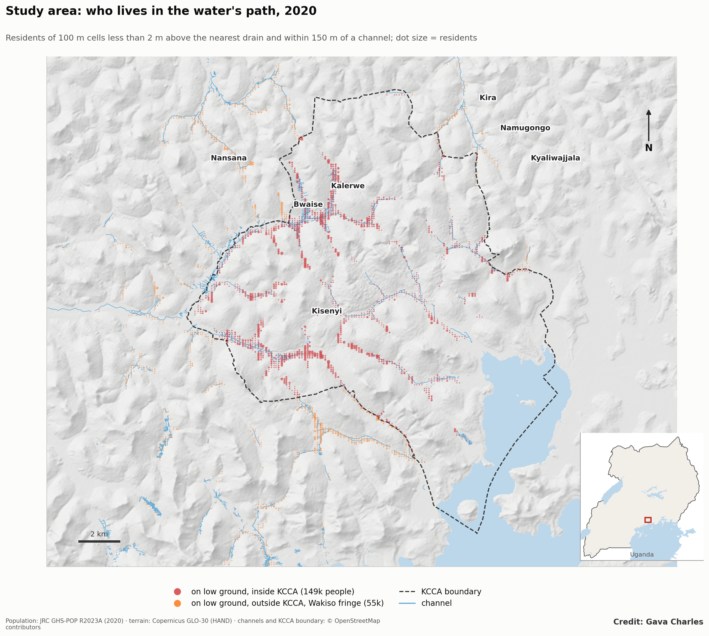
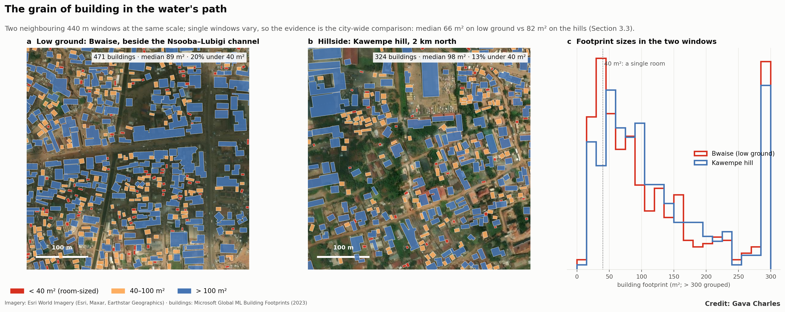
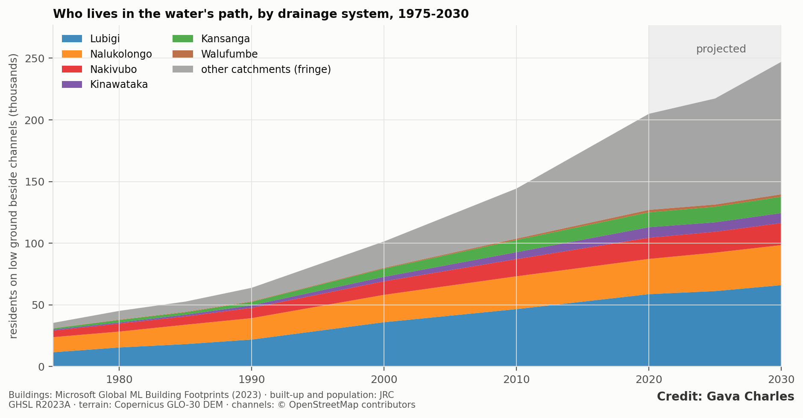
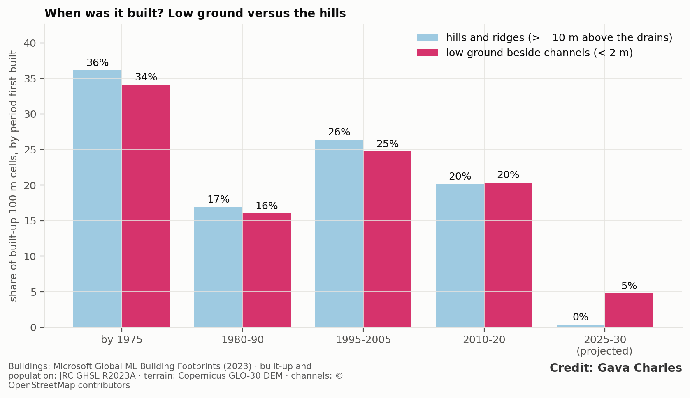
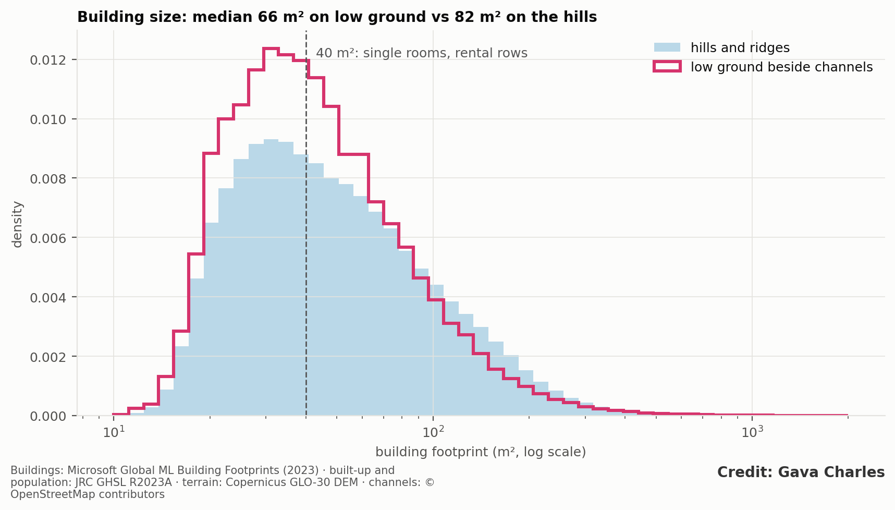
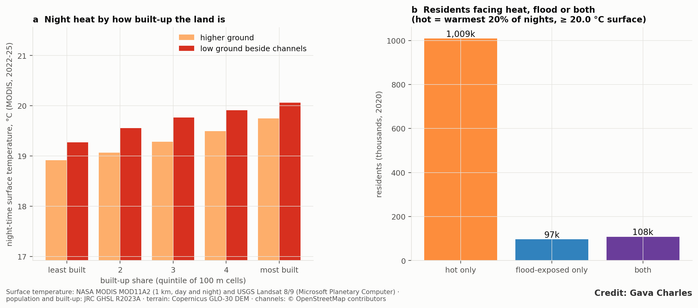
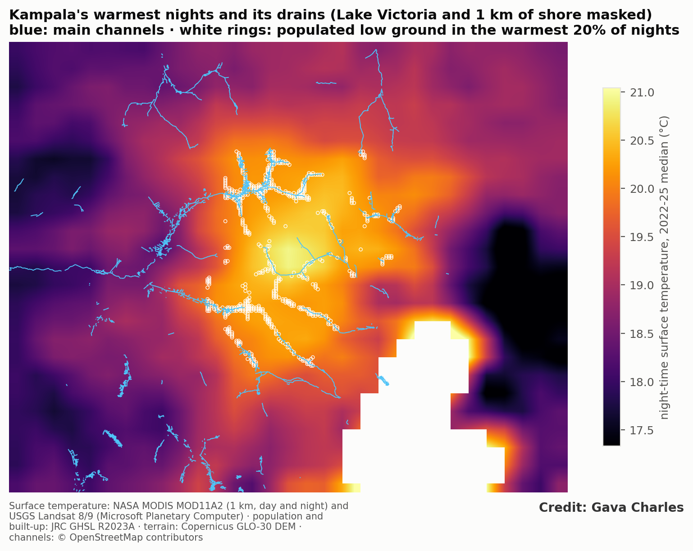
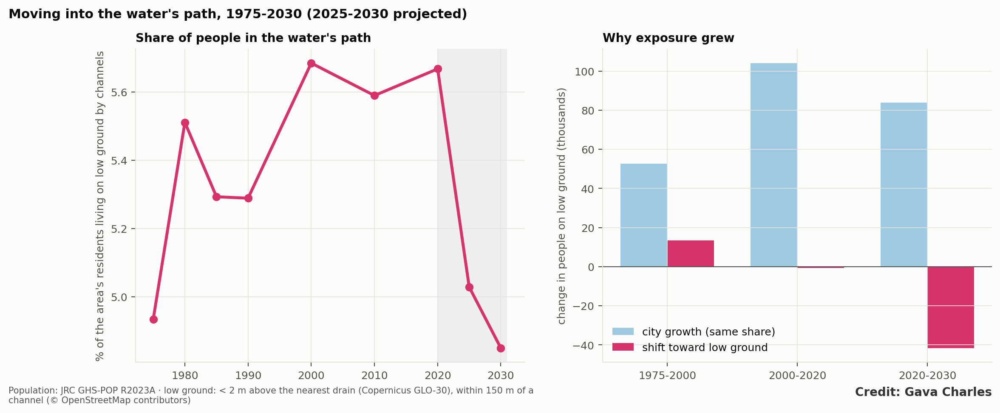
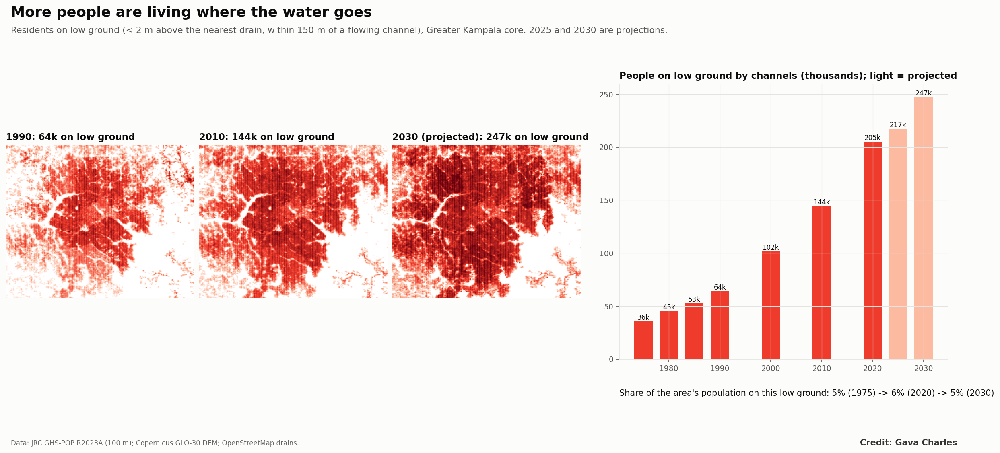

**Paper 3 of 5, Kampala drainage programme.** Merges earlier drafts D (*Building in the water's path*) and 5 (*Double exposure*).
**Target journals:** *Habitat International*; *Environment and Urbanization*; *World Development*; *Land Use Policy*.

# Abstract

Flood risk in African cities is usually framed as a hazard problem: heavier rain, undersized drains. Who lives where the water goes, how they came to live there, and what else they face there are less studied. We measure residential exposure along Greater Kampala's drainage network from 1975 to 2030 with open data: 6,914 channel stretches, a 30 m terrain model, JRC GHSL population and built-up layers, 537,000 building footprints, and MODIS night-time land-surface temperature.

1. **Exposure grew fivefold.** People on low ground (less than 2 m above the nearest drain, within 150 m of a channel) rose from about 36,000 in 1975 to 205,000 in 2020, projected at 247,000 by 2030. Low ground outgrew the city in 1975–2000 (4.3% vs 3.7% a year) and has kept pace with it since.
2. **Exposure has moved to the fringe.** Catchments outside the six main drainage systems held 4,300 exposed residents in 1975, 78,000 in 2020 and a projected 107,000 in 2030, more than any single system and largely outside KCCA's mandate. Projected new building in 2025–30 falls almost entirely on low ground (4.8% of built cells vs 0.4% on higher ground).
3. **A rental landscape.** Buildings on low ground are smaller (median 66 vs 82 m²) and more often room-sized (25% vs 20% under 40 m²), consistent with rental rows reached through Kampala's dual mailo–kibanja land system.
4. **The same people face the most heat.** 53% of low-ground residents live in the warmest fifth of night-time surfaces, against 29% on the hills (odds ratio 2.7), about 108,000 people. Low ground is 0.33 °C warmer at night than higher ground with the same density and vegetation (95% CI 0.25–0.41), and nights warmed about 0.8 °C between 2013–16 and 2022–25.

Exposure is now being created at the fringe, where development control is weakest, and it is compounded by heat for tenants in the city's densest, least ventilated housing. Land policy and green channel corridors address both hazards together.

# 1. Introduction

- **From hazard to people.** Paper 1 shows that Kampala's floods are driven by how the city built around its drains, not heavier rain. This paper asks who lives in the water's path, how they got there, and what else they face.
- **What is known.** Kampala's informal settlements cluster in wetlands and former floodplains (Arinabo 2024). KCCA reports houses in wetlands rising from 20,958 (2004) to 56,679 (2024). In a survey of 551 wetland households, tenants were more exposed to floods than landlords (OR 1.7; Isunju et al. 2016). Heat-health research in African cities is growing, and Kampala's nights are warming fastest of all its temperature measures (warm nights rose from about 22 to 60 a year between 1981–95 and 2011–25).
- **The land system.** Mailo, the dominant tenure, separates land ownership from ownership of developments (kibanja occupancy). Only leasehold land, under 30% of holdings, easily obtains formal subdivision approval. Mailo is strongly associated with informal housing (Bird and Venables 2020). Wetlands are public trust land under Article 237 of the Constitution, yet titles were issued; a 2014 directive to cancel post-1995 wetland titles has moved slowly.
- **Gap.** Studies of exposure are household surveys of particular settlements or scenario models of single catchments. There is no city-wide, observed account of how exposure grew since 1975, where it is moving, what the built form says about who lives there, and whether flood and heat exposure coincide.
- **Questions:**
  - RQ1: How has exposure on low ground changed since 1975 relative to city growth, and where is it growing?
  - RQ2: Does the timing and form of building on low ground differ from higher ground?
  - RQ3: Do the people exposed to floods also face the most heat?
  - RQ4: How do these patterns relate to Kampala's land system, and what follows for policy?

# 2. Study area: inner valleys and the fringe

The study box covers Kampala Capital City (195 km², governed by KCCA) and the most built-up parts of Wakiso district around it, including Nansana, Kira, Namugongo and Kyaliwajjala, which are separate municipalities with their own planning authorities. In 2020 about 204,000 people lived on low ground beside the channels: 149,000 inside the KCCA boundary and 55,000 outside it (Figure 1).

{width=100%}

Two kinds of low-ground settlement emerge:
- **Inner valleys**, settled before 1990: Bwaise and Kalerwe on the Lubigi–Nsooba, Kisenyi and Katwe on the Nakivubo, Ndeeba and Kibuye on the Nalukolongo. Dense, mixed rental and owner-occupied housing, markets and small industry line the channels.
- **Fringe valleys** in Wakiso, settled since 2000 and still filling: the upper Lubigi around Nansana, the Kinawataka headwaters around Kira and Namugongo, and the southern streams around Kajjansi.

Figure 2 shows the grain of building in a low-ground neighbourhood (Bwaise) beside a nearby hillside (Kawempe hill). Single windows vary, so the evidence for the difference is the city-wide comparison in Section 4.3. The window illustrates what it looks like on the ground: lanes of small rooms close against the channel.

{width=100%}

# 3. Data and methods

| Layer | Source | Use |
|---|---|---|
| Channels | OpenStreetMap; 6,914 stretches draining ≥ 0.25 km² (Paper 1) | "Beside a channel" (≤ 150 m) |
| Terrain | Copernicus GLO-30; HAND | Low ground (HAND < 2 m); hills (HAND ≥ 10 m) |
| Population, built-up 1975–2030 | JRC GHS-POP and GHS-BUILT R2023A (2025, 2030 projected) | Exposure; settlement age; crowding |
| Buildings | Microsoft Global ML Building Footprints (2023) | Building size and grain |
| Night and day heat | NASA MODIS MOD11A2, 1 km, medians 2013–16 and 2022–25; Landsat 8/9 ST where available | Heat exposure |
| Vegetation | Landsat NDVI, dry season 2022–25 | Control |

- **Exposure:** residents in 100 m cells on low ground, by channel system and epoch; compound growth compared with hills and the whole area; decomposition into city growth at a constant share and a shift toward low ground.
- **Settlement age:** the first GHSL epoch at which a cell reached 20% built.
- **Building form:** footprint median, share under 40 m² (single rooms, rental rows) and over 200 m², roof cover, and residents per built hectare.
- **Heat:** night-time surface temperature (about 22:30 local) as the primary measure; "hot" = warmest 20% of populated cells; open water and 1 km of lake shore excluded. People-weighted odds ratio of heat given flood exposure; weighted least squares of night temperature on low ground, built-up share and NDVI, with 2 km block-clustered errors; comparisons within built-up quintiles.
- **Tenure:** no open parcel-level tenure data exists, so links to the land system are interpretive hypotheses for cadastral testing.

# 4. Results

## 4.1 Exposure grew fivefold, first faster than the city, then with it

| | 1975 | 1990 | 2000 | 2010 | 2020 | 2030 (proj.) |
|---|---|---|---|---|---|---|
| Residents on low ground beside channels | 35,600 | 64,000 | 101,600 | 144,500 | 205,100 | 247,200 |

| Compound annual growth | Low ground | Hills | Whole area |
|---|---|---|---|
| 1975–2000 | **4.3%** | 3.5% | 3.7% |
| 2000–2020 | 3.6% | 3.5% | 3.6% |
| 2020–2030 (proj.) | 1.9% | 3.6% | 3.5% |

In 1975–2000, 13,400 more people moved onto low ground than city growth alone explains (Figure S1). Since 2000, exposure has grown at the city's pace.

## 4.2 The centre of exposure has moved to the fringe

| Residents on low ground | 1975 | 2000 | 2020 | 2030 (proj.) |
|---|---|---|---|---|
| Lubigi | 11,800 | 36,100 | 58,900 | 66,200 |
| Nalukolongo | 12,300 | 22,200 | 28,600 | 32,500 |
| Nakivubo | 5,300 | 11,000 | 17,200 | 17,900 |
| Kansanga | 900 | 6,700 | 12,000 | 13,200 |
| Kinawataka | 900 | 3,600 | 8,600 | 8,100 |
| Walufumbe | 100 | 600 | 2,000 | 2,000 |
| **Other (fringe) catchments** | **4,300** | **21,400** | **77,900** | **107,400** |

By 2030 the fringe catchments are projected to hold over 40% of the total (Figure 3), matching Paper 1's emerging-risk and design-drift maps. Low ground and hills were settled at the same pace until now (median first-built year 1990 for both), but in the projected 2025–30 period new built cells are almost all on low ground (4.8% vs 0.4%; Figure 4): as higher land fills, building is pushed onto the remaining valley floors.

{width=100%}

{width=100%}

## 4.3 A finer grain of building on low ground

| Building form (2023) | Low ground beside channels | Hills and ridges |
|---|---|---|
| Buildings | 22,225 | 338,112 |
| Median footprint | **66 m²** | 82 m² |
| Under 40 m² (single rooms, rental rows) | **25%** | 20% |
| Over 200 m² | 11% | 13% |
| Residents per built hectare (2020) | 377 | 367 |

The finest grain is on the Kinawataka and Walufumbe low ground (median 58 and 51 m²; a third under 40 m²); the coarsest is along Nakivubo (87 m²), lined by commercial and industrial buildings (Figure 5).

{width=100%}

## 4.4 The same people face the most heat

| | All residents | Flood-prone low ground | Hills |
|---|---|---|---|
| Share in the warmest 20% of nights | 31% | **53%** | 29% |
| Mean night surface temperature (°C) | | 19.8 | 19.4 |
| Mean day surface temperature (°C) | | 32.6 | 31.5 |

People-weighted odds ratio of heat given flood exposure: 2.7, about 108,000 people. Controlling for built-up share and vegetation, low ground is 0.33 °C warmer at night (95% CI 0.25–0.41), and 0.3–0.5 °C warmer within every built-up quintile (Figure 6). Dense construction and still air in the enclosed valley floors outweigh any cooling from cold-air pooling. Night-time surface temperature rose about 0.8 °C between 2013–16 and 2022–25, on low ground and hills alike. The double exposure follows the central valleys of Nakivubo, Lubigi–Bwaise–Kalerwe, Nalukolongo and Kinawataka (Figure 7).

{width=100%}

{width=100%}

# 5. Discussion: the land system behind the exposure

**5.1 Why low ground fills.**
- **Cheap, accessible land.** Valley floors are the cheapest land within reach of jobs; flooding and poor drainage depress their price.
- **Access without title.** Under mailo, land can be occupied and built on through kibanja purchase or room rental without registered title or planning approval, the only route open to most households.
- **Rental supply.** The finer grain on low ground fits rows of single-room rentals ("muzigo") built by small landlords for tenants, consistent with Isunju et al.'s finding that tenants carry most flood exposure.

**5.2 Public trust land in a private market.** Wetland titles were issued, informal sales took place, and industrial estates were sited in wetlands under earlier policies. The cancellation of post-1995 wetland titles has moved slowly, with court injunctions and only hundreds of cancellations against an estimated 20,000 titles nationally. Enforcement tends to fall on the most visible, least protected occupants while titled developments persist. The result keeps the valley floor in the land market without the drainage, services or security that formal development would bring.

**5.3 Compound risk in the rental stock.** Floods and heat strike the same neighbourhoods, which are low-income and densely built, with small single-room dwellings that are poorly ventilated and hard to cool. Heat-health and flood programmes should share one target map.

**5.4 Exposure is now made at the fringe.** About 27% of today's low-ground residents already live outside the KCCA boundary, and that share is growing. The fringe catchments of Wakiso (Kira, Nansana, Namugongo, Kyaliwajjala) are where the projection places almost all new low-ground building, where KCCA's mandate does not reach, and where mailo and kibanja transactions are common.

**5.5 Policy.**
- **Map and gazette the remaining fringe valley floors now**, using the open low-ground layer as a first screen, before subdivision.
- **Bring kibanja and rental housing within planning:** recognise local-council records in subdivision approval, paired with a no-build valley-floor zone.
- **Protect tenants where removal is neither feasible nor just:** flood early warning, raised floors, minimum ventilation and rental-room standards, and heat-health warnings.
- **Green the channel corridors.** Restored vegetated corridors add flood storage (Paper 2) and cool the valley floors at night (about −0.5 °C per 0.1 NDVI).
- **Resolve wetland titles transparently**, starting with large titled parcels.
- **Coordinate across KCCA, Wakiso and Mukono**, since exposure has moved beyond the city's boundary.

**5.6 Limitations.**
- **Tenure links are interpretive.** The next step is to overlay the exposure layer with the national cadastre and KCCA building approvals.
- **Modelled population.** GHS-POP cannot distinguish tenants from owners; 2025–30 values are projections.
- **Footprints** miss some small structures and merge attached rows, so the grain difference is conservative.
- **Surface temperature is not air temperature**, and 1 km MODIS blurs narrow valleys. Air-temperature loggers on a valley-to-ridge transect would test the night-air result directly.
- **Thresholds.** Low ground is a screening threshold (HAND < 2 m, ≤ 150 m); direction is robust to 1–3 m.

# 6. Conclusion

About 205,000 people now live on low ground beside Kampala's channels, five times as many as in 1975. The first phase moved people disproportionately onto the valley floors; the second followed the city's growth; the next is moving to the fringe, where almost all projected new low-ground building lies and development control is weakest. The people in the water's path live at a finer grain, consistent with rental rooms reached through the dual land system, and more than half of them also live in the city's hottest nights. Reducing future losses depends as much on land policy and green corridors as on drains.

# Data and code availability

Code: `src/kd_paperD.py`, `kd_heat.py`, `kd_network.py`. Results: `results/kd_paperD_*.csv`, `kd_heat_*.csv`.

# Figures

Figures are embedded in the text.

# Supplementary figures

{width=100%}

{width=100%}

# References

Items marked † were found through search, or are grey literature not yet opened; verify them before submission.

1. † Amooti Godfrey Nyakaana v. National Environment Management Authority and others. Constitutional Court of Uganda (2009); Supreme Court of Uganda (2015).
2. Arinabo, D. (2024). Understanding the evolving nature of urban flood risks in sub-Saharan Africa: the case of Kampala City, Uganda. IntechOpen.
3. Bird, J. and Venables, A. J. (2020). Land tenure and land-use in a developing city: a quantitative spatial model applied to Kampala, Uganda. *Journal of Urban Economics* 119, 103268. doi:10.1016/j.jue.2020.103268
4. Bowler, D. E., Buyung-Ali, L., Knight, T. M. and Pullin, A. S. (2010). Urban greening to cool towns and cities: a systematic review. *Landscape and Urban Planning* 97, 147–155. doi:10.1016/j.landurbplan.2010.05.006
5. Cameron, A. C. and Miller, D. L. (2015). A practitioner's guide to cluster-robust inference. *Journal of Human Resources* 50(2), 317–372.
6. † Daily Monitor (2023). Govt to cancel 20,000 land titles in wetlands.
7. Douglas, I. et al. (2008). Unjust waters: climate change, flooding and the urban poor in Africa. *Environment and Urbanization* 20(1), 187–205. doi:10.1177/0956247808089156
8. Goodfellow, T. (2013). Planning and development regulation amid rapid urban growth: explaining divergent trajectories in Africa. *Geoforum* 48, 83–93. doi:10.1016/j.geoforum.2013.04.007
9. Government of Uganda. Constitution (1995), Article 237; Land Act, Cap. 227 (1998); National Environment Act (2019); National Environment (Wetlands, River Banks and Lake Shores Management) Regulations, S.I. No. 3 of 2000.
10. Imhoff, M. L. et al. (2010). Remote sensing of the urban heat island effect across biomes. *Remote Sensing of Environment* 114, 504–513. doi:10.1016/j.rse.2009.10.008
11. Isunju, J. B., Orach, C. G. and Kemp, J. (2016). Hazards and vulnerabilities among informal wetland communities in Kampala, Uganda. *Environment and Urbanization* 28(1), 275–293. doi:10.1177/0956247815613689
12. † KCCA (2024). Kampala moves to protect wetlands as loss reaches alarming levels.
13. Lwasa, S. (2010). Adapting urban areas in Africa to climate change: the case of Kampala. *Current Opinion in Environmental Sustainability* 2(3), 166–171.
14. Microsoft (2023). Global ML Building Footprints.
15. † Muinde, K. (2013). Land tenure and informal land access in Kampala. MSc thesis, ITC, University of Twente.
16. Nobre, A. D. et al. (2011). Height Above the Nearest Drainage. *Journal of Hydrology* 404, 13–29.
17. Oke, T. R. (1982). The energetic basis of the urban heat island. *Quarterly Journal of the Royal Meteorological Society* 108, 1–24. doi:10.1002/qj.49710845502
18. Peng, S. et al. (2012). Surface urban heat island across 419 global big cities. *Environmental Science & Technology* 46, 696–703. doi:10.1021/es2030438
19. Pesaresi, M. and Politis, P. (2023); Schiavina, M. et al. (2023). GHS-BUILT-S and GHS-POP R2023A. European Commission, JRC.
20. Rentschler, J. et al. (2023). Global evidence of rapid urban growth in flood zones since 1985. *Nature* 622, 87–92. doi:10.1038/s41586-023-06468-9
21. Tellman, B. et al. (2021). Satellite imaging reveals increased proportion of population exposed to floods. *Nature* 596, 80–86. doi:10.1038/s41586-021-03695-w
22. † Wan, Z., Hook, S. and Hulley, G. (2021). MODIS/Terra Land Surface Temperature/Emissivity 8-Day L3 Global 1 km (MOD11A2 V061). NASA LP DAAC. doi:10.5067/MODIS/MOD11A2.061
23. Zscheischler, J. et al. (2018). Future climate risk from compound events. *Nature Climate Change* 8, 469–477. doi:10.1038/s41558-018-0156-3
24. Companion papers: 1 (*Rainfall or drainage?*), 2 (*The double loss*), 5 (*The next Kampalas*).
