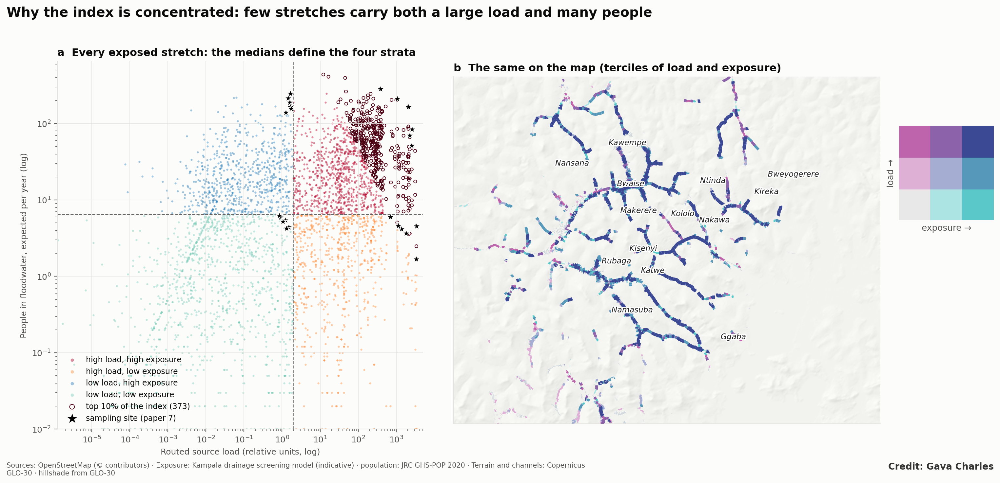
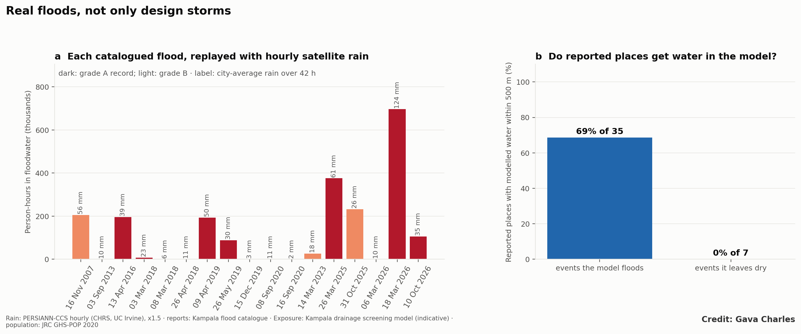
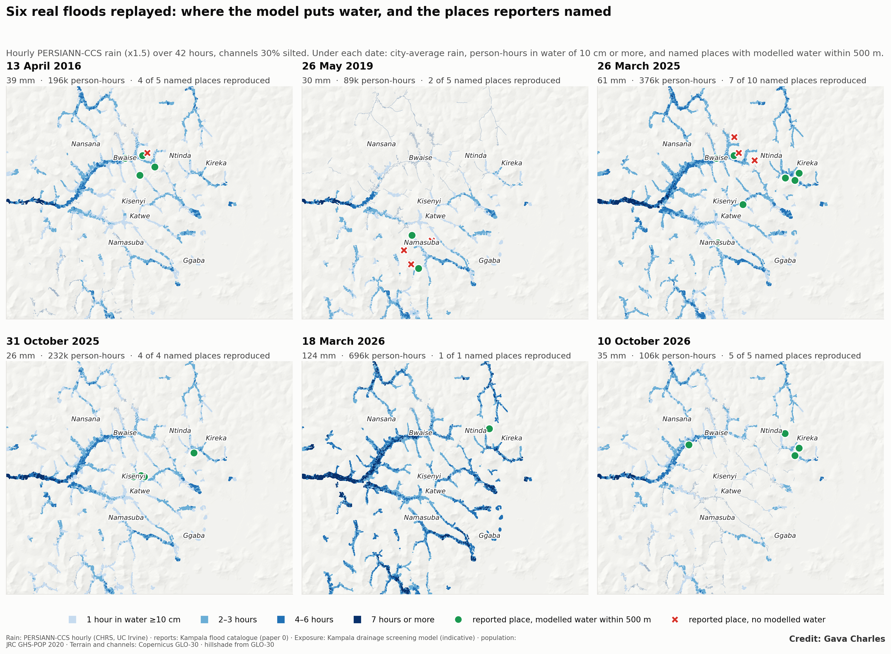
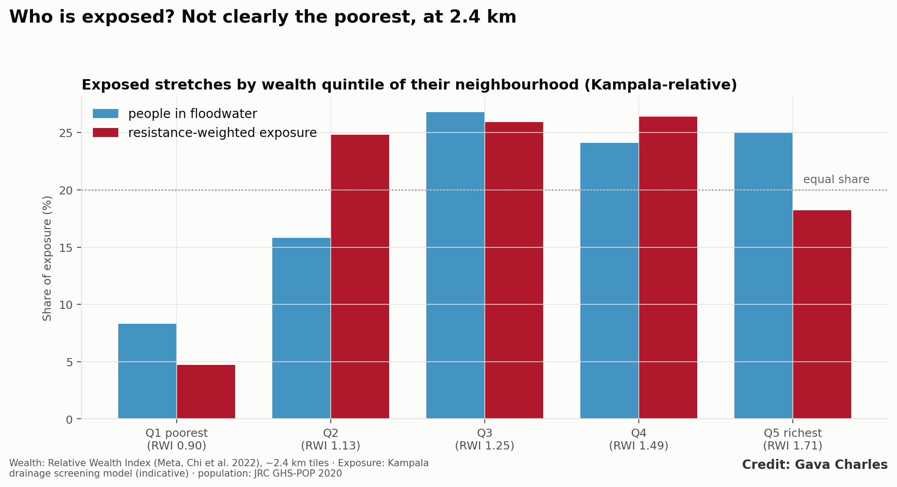
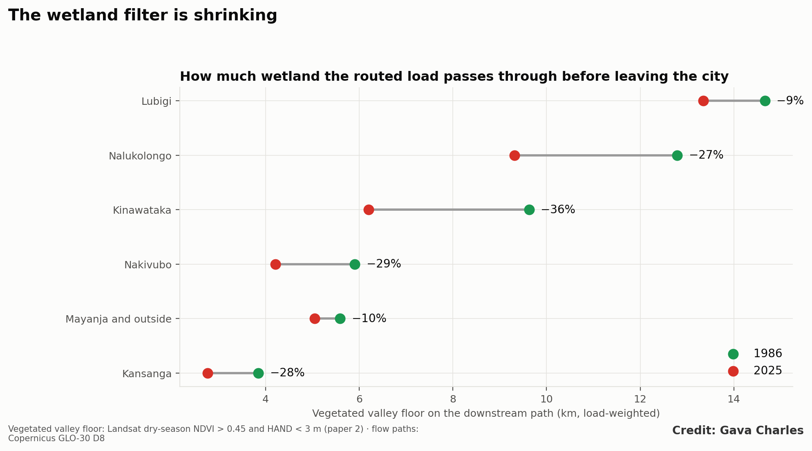
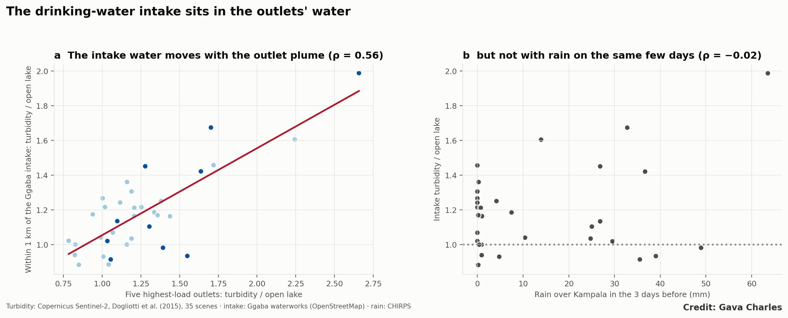
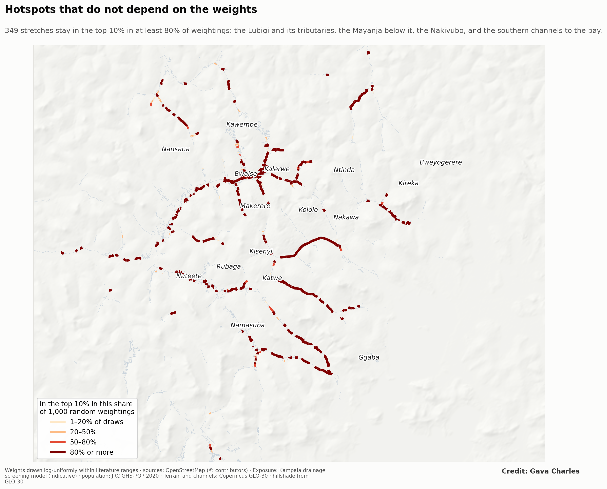
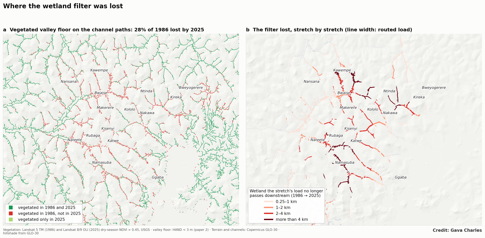
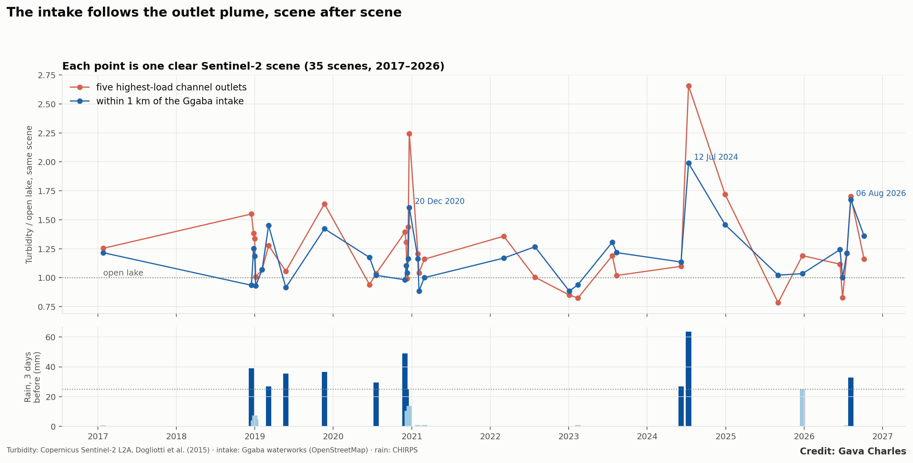

**Paper 6, Kampala drainage programme.** First of two linked papers on floods and antimicrobial resistance (AMR). This paper uses open geospatial data and remote sensing only; paper 7 will measure resistance in the field at the sites selected here.
**Target journals:** *Science of the Total Environment*; *Environment International*; *GeoHealth*; *Environmental Research: Health*.

# Abstract

Floods in African cities carry sewage, latrine contents, hospital effluent and waste into streets and homes. These are the main environmental reservoirs of antibiotic-resistant bacteria and resistance genes, Floods elsewhere raise resistance genes in rivers and soils, and Kampala's channels, wetland and bay already carry antibiotics, resistance genes and resistant bacteria, yet where flood paths and resistance sources overlap has not been mapped for any African city. We build an open, reproducible screening of that overlap for Greater Kampala, Uganda.

We inventoried potential sources from open data: 220 hospitals, 926 clinics, two wastewater treatment works, one mapped abattoir, 119 markets and 1,325 waste sites, with on-site sanitation carried by population (GHS-POP). Each source class was routed down a 30 m terrain model to 6,914 channel stretches, and combined with literature-ranked relative weights into a routed source load. Flood exposure came from the Kampala drainage screening model: people, buildings and 2,655 water points on 30 m squares under 10 cm or more of water, integrated over storms from the 2-year to the 100-year event. A hotspot index multiplies routed load by expected annual people exposed. We replayed 17 catalogued real floods with hourly satellite rain, related exposure to neighbourhood wealth, traced how much valley wetland the load passes before leaving the city in 1986 and 2025, and checked the load against Sentinel-2 turbidity at channel outlets and at the city's drinking-water intake.

1. **Exposure is large.** With today's silted channels, about 73,000 people a year are expected to stand in floodwater draining from these sources, and 153,000 in a 10-year storm.
2. **It is concentrated.** The top 10% of exposed stretches (373) hold 89% of the index. The Lubigi system alone holds half, and the Mayanja downstream of it a further 28%.
3. **The ranking is robust.** 349 of the 373 top stretches stay in the top 10% in at least 80% of 1,000 random weightings. The top 10% is unchanged without the treatment works, and 85–89% the same when only health facilities or only sanitation are counted.
4. **Maintenance cuts exposure by more than half.** Clean channels reduce expected annual exposure from 73,000 to 29,000 people and the index by 58%.
5. **A satellite check partly supports the load.** At 42 channel outlets on Inner Murchison Bay, in 36 Sentinel-2 scenes, outlets carrying more routed load were murkier than other outlets on the same day after heavy rain (permutation p = 0.03), but not in dry spells (p = 0.22) or across all scenes (p = 0.11).
6. **Real floods agree with the design storms.** Replaying 17 catalogued floods gives the same ranking of stretches (ρ = 0.99; 88% of the top 10% shared), and in events the model floods, 69% of the places named in reports had modelled water within 500 m. The flood of 18 March 2026 alone put about 700,000 person-hours in floodwater.
7. **The wetland filter is shrinking.** On the systems that drain to Inner Murchison Bay, the load now crosses 28–36% less vegetated valley floor than in 1986.
8. **The drinking-water intake sits in the outlets' water.** Turbidity near the Ggaba intake rose and fell with the plume of the five highest-load outlets (ρ = 0.56, p = 0.0004, 35 scenes).
9. **Exposure is not clearly concentrated on the poorest at 2.4 km.** The poorest wealth quintile holds 5% of resistance-weighted exposure; the data are too coarse to separate valley-floor settlements from the hills beside them.

Six of seven sites where resistance has already been measured in Kampala lie beside top-10% stretches. The result is a map of where resistance in floodwater is most likely to reach people, and a stratified frame of 30 sampling sites for the field study that will test it.

# 1. Introduction

**Antimicrobial resistance is a leading cause of death.** Bacterial AMR was associated with an estimated 4.95 million deaths in 2019 and directly caused 1.27 million, with the highest rates in sub-Saharan Africa (Murray et al., 2022). Most attention goes to hospitals and antibiotic use. The environment also matters: sewage, wastewater treatment works, hospital effluent and animal waste carry resistant bacteria and resistance genes into rivers and soils, where people meet them again (Berendonk et al., 2015; Larsson and Flach, 2022). Treatment works are recognised hotspots (Rizzo et al., 2013; Karkman et al., 2018), and urban sewage carries a resistance signature that differs between regions (Hendriksen et al., 2019).

**Floods connect these reservoirs to people.** Urban floodwater carries faecal pathogens at concentrations that pose infection risks to people who wade through it (ten Veldhuis et al., 2010; de Man et al., 2014), and more frequent extreme rain is expected to raise environmental AMR contamination, although direct studies are few (van Bavel et al., 2024). In cities where most people rely on pit latrines and septic tanks, and where channels run through dense settlements and past markets and waste dumps, a flood mobilises the whole faecal and clinical load of a catchment and spreads it across valley floors where people live.

**Floods move resistance, but where they meet people has not been mapped.** The few studies that sampled floods found more resistance genes, not fewer. In the River Trent, almost every resistance gene measured was more abundant during a flood than at baseline, and untreated sewage overflows were the main source (Spurr et al., 2026). Floodwater in four districts of Bangladesh in 2024 carried multidrug-resistant *Klebsiella pneumoniae* and mobile resistance plasmids (Rahman et al., 2025), and 103 resistance genes were found at sites flooded in Kerala in 2018 (Jaya Divakaran et al., 2019). Urban soils in Houston carried more resistance genes three to five months after Hurricane Harvey than at 18 months (Pérez-Valdespino et al., 2021); riverine resistance genes in Colorado returned close to pre-flood levels within ten months (Garner et al., 2016); and in experiments, the longer soil is flooded, the more its resistome turns over (Xiang et al., 2023). All of these studies sampled after the fact, at sites chosen for access, and none is from a sub-Saharan African city or asks where flood paths and resistance sources coincide with the people exposed.

**Kampala's water already carries resistance.** Resistance among clinical pathogens in Uganda is high (Namusoosa et al., 2024); at Mulago, the national referral hospital, ESBL-producing bacteria were common on the maternity ward and most were multidrug-resistant (Mayanja et al., 2023). Outside the hospitals, the evidence follows the drainage. Antibiotics are carried from the Bugolobi treatment works down the Nakivubo channel, and partly removed in the Nakivubo wetland (Dalahmeh et al., 2020); sulfamethoxazole, trimethoprim and tetracycline are found in the water of Murchison Bay (Nantaba et al., 2020), and fluoroquinolones in its sediments at levels that pose ecological risk (Nantaba et al., 2024). Metagenomes along the Nakivubo found resistance genes and mobile genetic elements mainly in the treatment works, the channel and the wetland, much less in the lake (Ogola et al., 2025). Open sewage channels at Mulago and Kawaala carried resistance genes of several drug classes, including a carbapenemase (Strike et al., 2025); 73% of *E. coli* from wastewater in four Kawempe slums were resistant to at least one antibiotic (Byarugaba et al., 2025); and resistant *Salmonella* has been isolated from the Nakivubo channel (Afema et al., 2016). Faecal contamination of the Nakivubo wetland is high (Fuhrimann et al., 2015), latrines in Bwaise empty directly into drains (Katukiza et al., 2010), and pit latrines contaminate the shallow groundwater beneath the valley settlements (Nyenje et al., 2014). Each of these studies sampled a few sites at one time, and none related its samples to floods.

**Kampala is a clear case.** The city's channels drain hillsides where most households use on-site sanitation, past more than a thousand health facilities, markets and waste sites, to Inner Murchison Bay, the source of most of the city's drinking water. Earlier papers in this programme showed that Kampala's floods are made mainly by encroachment, constrictions, lost wetland and silted channels rather than heavier rain (papers 1 and 4), that hundreds of thousands of people now live on the valley floors (paper 3), and that the wetlands which once cleaned the water draining to the bay have halved (paper 2), as the bay's water quality declined (Akurut et al., 2017).

**What is missing is a map of where floodwater and resistance sources meet.** Field studies of AMR in African urban water are few and sample where access is easy; exposure studies of floods rarely consider what the water carries. A map of where the two meet would show where resistance in floodwater is most likely to reach people, and where a field study should sample to test that. We ask:
1. Where do potential sources of resistance lie in the path of floodwater?
2. How many people, buildings and water points are exposed, and how concentrated is that exposure?
3. How robust is the ranking to the large uncertainty in how much each source contributes?
4. How much would channel maintenance reduce exposure?
5. Do real floods, replayed with observed rain, rank places as the design storms do?
6. Who is exposed, and how has the wetland that once filtered this load changed?
7. Is there any independent sign of the load in the lake, and at the drinking-water intake?
8. Where should a field study sample to test the map?

# 2. Study area

Greater Kampala lies on hills between Lake Victoria and the papyrus valleys of the Lubigi, Nsooba, Nakivubo, Kinawataka, Kansanga, Nalukolongo and Walufumbe systems (Figure 1). Most channels drain south to Inner Murchison Bay; the Lubigi drains west through its wetland to the Mayanja River. Sewer coverage is low and concentrated in the centre; two treatment works, at Bugolobi (Nakivubo) and Lubigi, receive sewage and faecal sludge. Rain comes in two seasons, and heavy storms are short afternoon and night-time convective events.

# 3. Data and methods

## 3.1 Sources

Point sources were taken from OpenStreetMap (OpenStreetMap contributors, 2026; Table 1): hospitals and clinics (amenity or healthcare tags), markets, waste disposal sites, transfer stations and landfills, wastewater treatment works and abattoirs. Treatment works mapped as many buildings (tanks, filters) were merged into one plant within 500 m. Duplicate nodes and buildings of the same facility within 30 m were removed. On-site sanitation was represented by resident population (JRC GHS-POP, about 90 m, 2020 and 1990; Schiavina et al., 2023), per 1,000 people.

**Table 1. Sources and receptors.**

| Class | Count in the study area | Source |
|---|---|---|
| Hospitals | 220 | OpenStreetMap |
| Clinics and doctors | 926 | OpenStreetMap |
| Wastewater treatment works | 2 (Bugolobi, Lubigi) | OpenStreetMap |
| Abattoirs | 1 (Wambizzi) | OpenStreetMap |
| Markets | 119 | OpenStreetMap |
| Waste sites | 1,325 | OpenStreetMap |
| On-site sanitation | population | JRC GHS-POP |
| Water points (receptors) | 2,655 | Water Point Data Exchange |

## 3.2 Routing

Each source class was placed on the 30 m Copernicus GLO-30 terrain grid (European Space Agency, 2021) and accumulated downstream along D8 flow directions after filling pits and depressions (pysheds; Bartos, 2020), as for the runoff load in paper 1. Because accumulation is linear, each class was routed once. Each of the 6,914 channel stretches takes the routed values at its downstream-most point, giving the number of sources of each class upstream, A_c.

The routed source load of stretch k is

L_k = Σ_c w_c · A_c(k)

with relative weights w_c: treatment works 50, hospitals 10, abattoir 5, clinics 2, markets 1, waste sites 0.5 and 1 per 1,000 residents for sanitation. The weights rank expected loads of resistant faecal bacteria and resistance genes: treated and untreated wastewater and hospital effluent are the richest sources in the literature, followed by animal slaughter waste and dispersed human faecal sources. They are not measured concentrations, and Section 3.5 tests how much they matter.

## 3.3 Exposure

Flood exposure comes from the Kampala drainage screening model (papers 1 and 4). For each stretch and each design storm (2, 5, 10, 25, 50 and 100 years), the model gives the overbank water level from the stretch's rating curve built on the height of every 30 m square above its drain (HAND). A square is flooded when the water level exceeds its height by 10 cm or more, about a doorstep. On each flooded square we counted residents (GHS-POP shared over its 30 m squares), building footprints (Microsoft Global ML Building Footprints) and water points (WPdx). Expected annual exposure integrates these counts over annual exceedance probability, with the 100-year value held beyond.

Three states were run: today (2020 paving, channels silted to 30% of their depth), clean channels (2020 paving, full capacity) and the 1990 city (1990 paving and population, channels at design capacity).

## 3.4 Hotspot index

H_k = (L_k / median L) · E_k

where E_k is the expected annual number of people in floodwater on stretch k. The index is high where much of the catchment's source load passes and where many people are flooded.

## 3.5 Robustness

- **Weights.** 1,000 draws of all weights, each log-uniform within its range (treatment works 20–100, hospitals 5–20, abattoir 2–10, clinics 1–4, markets 0.5–2, waste 0.2–1, sanitation 0.5–2). For each stretch we record the share of draws in which it is in the top 10%.
- **Structure.** Overlap of the top 10% with five variants: without treatment works; health facilities only; sanitation only; exposure counted as buildings; clean channels.

## 3.6 Real floods

Design storms describe expected exposure; Paper 7 will need the exposure of each real flood. For every flood in the Kampala flood catalogue (paper 0; Gava, 2026a) dated to the day, we ran the hourly model of the Kampala Flood Replay on PERSIANN-CCS hourly satellite rain (Hong et al., 2004) for 42 hours around the event (rain × 1.5, channels 30% silted, as in the replay). For each event and stretch we computed person-hours, building-hours and water-point-hours in water of 10 cm or more, and resistance-weighted person-hours. We checked whether each place named in the event's reports had modelled water within 500 m, and compared the ranking of stretches by summed event exposure with the design-storm ranking.

## 3.7 Who is exposed

For each stretch we attached the Relative Wealth Index (Chi et al., 2022; tiles of about 2.4 km), the median footprint of buildings on its floodable squares (small, dense buildings mark informal housing) and the number of WPdx water points within 500 m per 1,000 residents. Exposed stretches were split into Kampala-relative wealth quintiles and the share of people in floodwater and of resistance-weighted exposure (load × expected annual people) in each was computed, with a concentration index over wealth rank (negative values mean exposure is borne by the poorer).

## 3.8 The wetland filter

Valley wetlands remove faecal bacteria and resistance genes before water reaches the lake or the Mayanja. Using the vegetated valley floor of paper 2 (Landsat dry-season NDVI > 0.45 on ground less than 3 m above the nearest drain) for 1986 and 2025, we traced the D8 path downstream from each stretch to the edge of the map and measured how much of it runs through vegetated valley floor. The load-weighted mean of that length, by system and year, measures how much wetland the routed load passes before leaving the city.

## 3.9 Satellite check at the bay

Routed load is a model quantity. As an independent check, we asked whether lake water off the channel outlets that carry more load is murkier. Outlets were land cells within 60 m of the open water of Inner Murchison Bay (the water mask of paper 2) where flow accumulation is at least 0.25 km²; cells within 400 m form one outlet, giving 42 outlets. In each of 36 cached Sentinel-2 L2A scenes (2018–2026), we took the median turbidity (Dogliotti et al., 2015) of open-water pixels within 400 m of each outlet, divided by the median of the open-lake reference zone in the same scene; outlets with fewer than 20 valid pixels in a scene were skipped. Rain is CHIRPS (Funk et al., 2015) over Kampala in the three days before each scene; scenes with 25 mm or more are wet.

Two tests: (1) across outlets, Spearman correlation of the mean log ratio with log routed load; (2) within scenes, the slope of log ratio on log(1 + load) after removing each scene's mean, for all, dry and wet scenes. Because outlet-days are not independent, p-values come from permuting routed load among the 40 outlets with at least five usable scenes, 2,000 times. Turbidity measures sediment and runoff, not resistance: the test asks whether routed load marks where catchment discharge reaches the lake, not whether resistance does.

## 3.10 The drinking-water intake

The Ggaba waterworks draw from Inner Murchison Bay at 32.639 E, 0.244 N (OpenStreetMap). In each Sentinel-2 scene with enough clear water, we took the median turbidity within 1 km of the intake over the open-lake reference, and related it to the median signal of the five highest-load outlets on the same day (Section 3.9) and to three-day rain.

## 3.11 Sampling frame

Stretches with flood exposure were split at the median into high or low routed load and high or low exposure. In each of the four strata, and among upland stretches without flood exposure (controls), we selected the six highest-ranked stretches at least 1 km from every other selected site, giving 30 sites for paper 7.

# 4. Results

## 4.1 Sources and routed load

Sources are dense in the centre and along the main roads (Figure 1). Routed load rises downstream, steeply where channels pass through the dense northern and central settlements (Figure 2). The highest loads are on the lower Lubigi and the Mayanja below it, which receive the Lubigi treatment works, the north-western hospitals and clinics, and the largest residential catchments; then the Nakivubo, through the centre and past the Bugolobi works.

## 4.2 Exposure

With today's silted channels, about **73,000 people a year** are expected to be in floodwater on stretches carrying these sources, together with about 5,400 buildings a year. In a 10-year storm, 153,000 people and 35 water points are flooded. Few mapped water points stand on the valley floors (17 a year expected), but those that do are protected springs and wells used by the poorest households.

## 4.3 Hotspots

The index is strongly concentrated (Figures 3 and 4a). The **top 10% of exposed stretches (373) hold 89% of the index** but only 36% of exposed people: they are where large exposure and large upstream load coincide. Of those 373, 363 lie above the median of both load and exposure (Figure 5), and that quadrant, 31% of exposed stretches, holds 97% of the index. By system, the Lubigi holds 50% of the index, the Mayanja and other catchments outside the city 28%, the Nakivubo 9%, the Kansanga 6%, and the Nalukolongo and Kinawataka 3% each (Figure 6b).

## 4.4 Robustness

**The ranking survives the weight uncertainty** (Figure 4b; mapped in Figure S1): 349 of the 373 top stretches are in the top 10% in at least 80% of the 1,000 weightings: 137 on the Lubigi, 113 on the Mayanja and outside catchments, 31 on the Nakivubo, 28 on the Kansanga, 23 on the Nalukolongo and 17 on the Kinawataka. Structural variants change little (Table 2). Removing the treatment works leaves the top 10% unchanged: the hotspots are driven by the dense sanitation and health-facility load of their catchments, not by the plants. Counting only health facilities or only sanitation keeps 89% and 85% of the top stretches. Counting buildings instead of people keeps 64%, because building counts weight commercial areas more.

**Table 2. Overlap of the top 10% of stretches with structural variants.**

| Variant | Overlap with the main top 10% |
|---|---|
| Without treatment works | 100% |
| Health facilities only | 89% |
| Sanitation only | 85% |
| Clean channels | 85% |
| Exposure counted as buildings | 64% |

## 4.5 Maintenance and change

**Clean channels would cut expected annual exposure from 73,000 to 29,000 people** (Figure 6a), buildings from 5,400 to 1,800 a year, and the index by 58%. In a 10-year storm, clean channels would still flood about 99,000 people: maintenance removes most exposure in frequent storms, not in rare ones.

In the 1990 city (1990 paving and population, channels at design capacity), expected annual exposure was about 2,300 people, 3% of today's. This comparison combines more people on the valley floors, more paving and silted channels; papers 3 and 4 separate those drivers for flooding. Health facility counts were held at today's, so the 1990 load is overstated, which makes the comparison conservative.

## 4.6 Real floods

Seventeen catalogued floods had complete hourly satellite rain (Figure 7a). Modelled exposure followed event rain closely (Spearman ρ = 0.93 across events): the flood of 18 March 2026, with 124 mm over 42 hours, put about **700,000 person-hours** in water of 10 cm or more, and the three largest events (March 2026, March 2025 and October 2025) hold 61% of the 2.1 million person-hours summed over all events. In seven events the satellite recorded 11 mm or less over Kampala and the model gave almost no flooding, although floods were reported: these are short storms whose cores the 4 km satellite missed.

Where the model floods, it floods the reported places (Figure 7b): in the ten events with modelled flooding and named places, 24 of 35 places (69%) had modelled water within 500 m, against none of 7 in events the model left dry. Bwaise, Kalerwe, Kinawataka, Kyambogo, the Nakivubo channel and the Lubigi at Hoima Road were all reproduced (Figure 8); the misses cluster in the 26 May 2019 storm south of the city (Kikajjo, Masajja, Bunamwaya) and north of Kalerwe in March 2025 (Kanyanya, Kyebando, Bukoto), places that may have flooded from local storm cores or from roadside drains the model does not represent.

The largest event shows how fast this happens (Figure S2, Movie S1). On 18 March 2026, rain of 20–31 mm an hour between 07:00 and 09:00 put about 171,000 people in water at the 09:00 peak; by 13:00 it was 7,000, mostly on the lower Lubigi. Exposure lasts hours, not days, so samples for Paper 7 must be taken within a day of a storm.

**Real floods rank the stretches as the design storms do.** Summed over events, resistance-weighted person-hours correlate with the design-storm hotspot index at ρ = 0.99 across exposed stretches, 88% of the top 10% are the same, and the design top 10% hold 94% of the events' resistance-weighted person-hours. The Lubigi holds 54% of it and the Mayanja and outside catchments 32%, as in Section 4.3. Each event therefore gives Paper 7 a stretch-by-stretch exposure in hours for its flood-day samples.

## 4.7 Who is exposed

At the 2.4 km resolution of the wealth index, exposure is **not** concentrated in the poorest neighbourhoods (Figure 9). The poorest Kampala-relative quintile holds 8% of people in floodwater and 5% of resistance-weighted exposure; the middle three quintiles hold most of it, and the concentration index is slightly positive (0.11). The top-10% stretches sit in tiles slightly wealthier than other exposed stretches (median RWI 1.31 vs 1.25), and the footprints of their flooded buildings are no smaller (72 vs 76 m² median). We read this as a limit of the data rather than a finding about Kampala: a 2.4 km tile around Bwaise or Kalerwe averages valley-floor settlements with wealthier hillside housing, and the poorest valley-floor households are invisible at that scale. Parish-level census data, or a building-scale poverty proxy, are needed to answer who bears this exposure.

## 4.8 The wetland filter

The routed load passes through less wetland than it did in 1986 (Figure 10; mapped in Figure S3). Of the vegetated valley floor on the channel paths in 1986, 28% was no longer vegetated in 2025. Weighted by load, the vegetated valley floor on the path downstream fell from 9.3 km to 8.2 km city-wide. The losses are largest on the systems that drain to the bay: the Kinawataka by 36% (9.6 to 6.2 km), the Nakivubo by 29% (5.9 to 4.2 km), the Kansanga by 28% (3.8 to 2.8 km); the Nalukolongo lost 27%. The Lubigi still passes its large wetland (14.7 to 13.3 km, −9%). On the channels that reach Kampala's drinking-water source, the load now crosses about a third less wetland than a generation ago.

## 4.9 Satellite check

Across outlets, average turbidity relative to the open lake was unrelated to routed load (Spearman ρ = 0.07, p = 0.67): standing differences between outlets reflect shoreline shape, papyrus fringes and depth more than catchment load. Within scenes, outlets with more routed load were slightly murkier than other outlets on the same day, and the gradient appears after rain: the within-scene slope was positive after 25 mm or more in three days (permutation p = 0.033), flat in dry spells (p = 0.22), and not significant across all scenes (p = 0.11) (Figure 11). The pattern is what routed load should produce if it marks where catchment discharge reaches the lake during runoff; the effect is small and rests on 371 wet outlet-days.

## 4.10 The drinking-water intake

Water within 1 km of the Ggaba intake was a median 16% more turbid than the open lake across 35 scenes, and it moved with the plume of the five highest-load outlets: scene by scene, the two were strongly correlated (Spearman ρ = 0.56, p = 0.0004; Figure 12). The intake did not track three-day rain (ρ = −0.02), which suggests that what reaches it depends on the plume's extent and on wind and currents more than on the last few days of rain. The intake sits within the reach of the outlets' water. Through time (Figure S4), the three murkiest scenes at the intake, 12 July 2024, 6 August 2026 and 20 December 2020, were also three of the four murkiest at the outlets; the first two followed 33–63 mm of rain in three days.

## 4.11 Sampling frame

The 30 sites (Figure 13) span the four strata and six upland controls. High-load, high-exposure sites lie on the Lubigi and its Nsooba and Kalerwe tributaries; low-load, high-exposure sites on the southern and eastern channels; controls on upland tributaries without flood exposure.

# 5. Discussion

**Where the risk is.** Exposure to floodwater carrying resistance sources is not spread across Kampala. It is concentrated on a few hundred stretches of the Lubigi, the Mayanja downstream of it, and the Nakivubo, where dense unsewered settlements and many health facilities drain into channels that flood the homes beside them. These are also the channels that earlier papers ranked highest for maintenance and for people on low ground: the same places carry the flood, the people and the load.

**What the literature adds.** The measurements that exist in Kampala fit the map. The places where resistance genes, resistant bacteria and antibiotics have been found, the Nakivubo below the Bugolobi works, open channels at Mulago and Kawaala, and wastewater in Bwaise and Kazo (Dalahmeh et al., 2020; Ogola et al., 2025; Strike et al., 2025; Byarugaba et al., 2025), lie on stretches the index ranks high. Taking the approximate locations given in those papers, six of seven sites (the Mulago and Kawaala channels, Bwaise, Kazo, and the Nakivubo at Kisenyi and below Bugolobi) are within 600 m of an exposed stretch in the top 10%, three of them in the top 2%; the seventh, Makerere III, is in the top 20%. The published samples were taken where the index says the load is, but not when floods were carrying it. In the Trent the flood signal came from sewage overflows (Spurr et al., 2026); Kampala has few sewers to overflow, but its equivalent is the latrine emptied into a drain in the rain (Katukiza et al., 2010) and the pit flooded from below as the water table rises (Nyenje et al., 2014), which is why sanitation carried by population drives so much of the load.

**Why the ranking is credible despite uncertain weights.** No one has measured the resistance load of each source class in Kampala, so the weights are informed guesses. The ranking does not depend much on them: it holds across 1,000 weightings, without the treatment works, and with only one source class at a time. What drives it is geography: where many sources and many flooded people share a catchment, the product is high under any reasonable weighting.

**Maintenance as a public-health measure.** Desilting is usually justified by roads and property. This analysis adds a health argument: clean channels would remove more than half of the expected exposure to floodwater from these sources. The cheapest flood measure in Kampala is also an AMR measure.

**Water supply.** Most flooded water points are protected springs and shallow wells on valley floors, used by households without piped water. They are few in the WPdx inventory, which is far from complete in Kampala, but each one flooded is a direct route from floodwater to drinking water. Downstream, the channels that rank highest to the south discharge to Inner Murchison Bay above the Ggaba intake, where paper 2 found the water at channel outlets growing murkier relative to the open lake as the wetlands shrank.

**Real floods confirm the design-storm map.** The design storms are an abstraction; the catalogued floods are not. Replayed with hourly satellite rain, they rank the stretches almost exactly as the design storms do and flood most of the places reporters named, when the satellite catches the storm. They also show how uneven the burden is in time: three floods in the last two years hold most of the exposure of two decades of records, which matches the growth of valley-floor settlement and the silting documented in papers 3 and 4. For Paper 7 the replay matters most: it can give the exposure hours of each household and stretch for any future flood within a day of the event, using rain that is published within hours.

**Not only the poorest, at this resolution.** We expected resistance-weighted exposure to fall on the poorest neighbourhoods. At 2.4 km it does not: it falls on middle-wealth tiles where dense valley settlements sit beside wealthier hills. That is a statement about the scale of available poverty data, and a reason to collect household wealth in Paper 7.

**The wetland filter and the water supply.** Two results connect the flood map to Kampala's drinking water, and both agree with field measurements: antibiotics fall as the Nakivubo crosses its wetland (Dalahmeh et al., 2020), and resistance genes are concentrated upstream of the lake rather than in it (Ogola et al., 2025). The load on the bay-draining systems now crosses about a third less wetland than in 1986, and the water at the Ggaba intake rises and falls with the plume of the highest-load outlets. Restoring valley wetlands is therefore not only flood storage: it is the city's first treatment step for the water it later drinks.

**An independent signal.** The satellite check is weak but points the right way: after heavy rain, outlets carrying more routed load are murkier than other outlets the same day. Turbidity is not resistance, but it shows that the routing marks where catchment runoff reaches the lake when it rains, which is when floodwater is carrying the load.

**What the map cannot say.** It does not measure resistance. It ranks where resistance in floodwater is most likely to reach people, given where sources and floods are. Whether floods raise resistant bacteria and resistance genes in water, on surfaces and in people's guts, by how much and for how long, needs measurement. Flood studies elsewhere set the design. Resistance genes stay raised in soils for months (Pérez-Valdespino et al., 2021) but in rivers can recover within months (Garner et al., 2016), and culture methods perform poorly in turbid floodwater (Spurr et al., 2026). Paper 7 should therefore sample within a day of a flood and again at weeks and months, and pair culture with molecular methods. The sampling frame is designed for that: if the index is right, concentrations after floods will rise with routed load, and carriage will rise with exposure hours. Paper 7 will measure the class 1 integron-integrase gene intI1, a general marker of anthropogenic pollution and resistance (Gillings et al., 2015), resistance genes by quantitative PCR, and ESBL-producing *E. coli* by the WHO Tricycle protocol (World Health Organization, 2021), in water, sediment and household surfaces before and after floods at the 30 sites, so that results compare with surveillance elsewhere and feed Uganda's national action plan on AMR (Government of Uganda, 2018).

# 6. Limitations

- **Source inventory.** OpenStreetMap is incomplete in Kampala. Only one abattoir is mapped (the City Abattoir is not), sewer overflows and septage dumping sites are not mapped, and many small clinics, drug shops and livestock keepers are missing. Pharmacies were not used as sources. Heavy metals, which may co-select for resistance in Kampala's slum wastewater (Byarugaba et al., 2025), are not represented.
- **Sanitation.** Population stands in for on-site sanitation everywhere; sewered areas in the centre are therefore overweighted. Parish-level sanitation data from the census would improve this.
- **Weights.** Relative, literature-informed and untested in Kampala; the robustness tests bound their effect on the ranking but not on absolute exposure.
- **Routing.** Sources are routed with the terrain, not through sewers, storm drains or pipes. Decay, settling and wetland removal of bacteria and genes are not modelled: the load is a potential, not a concentration.
- **Floods.** The screening model has no surveyed channels or culverts and no surface water away from channels; depths are indicative (papers 1 and 4). Short local storms are underrepresented.
- **Receptors.** GHS-POP is modelled population; WPdx covers only part of Kampala's springs and wells.
- **Wealth.** The Relative Wealth Index is a model estimate at about 2.4 km and cannot separate valley-floor settlements from neighbouring hillside housing.
- **Wetland.** Vegetated valley floor (NDVI) includes some gardens and grass; it does not measure removal of bacteria or genes.
- **Real floods.** Satellite rain at 4 km misses the cores of short storms; events whose rain the satellite missed show no modelled flooding even when floods were reported.

# 7. Conclusion

Floodwater in Kampala passes through dense unsewered settlements, past more than a thousand health facilities, markets and waste sites, and into the homes of people on the valley floors. An open, reproducible screening shows where this matters most: a few hundred stretches, mainly the Lubigi, the Mayanja and the Nakivubo, hold nine-tenths of the hotspot index, and the ranking holds under wide uncertainty in source weights. Real floods, replayed with hourly satellite rain, rank the same places. Clean channels would halve the exposure; restoring the valley wetlands would restore the filter that the load on the bay-draining channels has lost a third of since 1986, upstream of an intake that already sits in the outlets' water. The 30-site frame provided here turns the map into a field test of whether floods carry resistance to people.

# Data and code

Open data only. Code: `src/am_sources.py` (inventory), `src/am_index.py` (routing, exposure, index, robustness, sampling frame), `src/am_figs.py` (figures and variants), `src/am_satcheck.py` (satellite check), `src/am_events.py` (real floods), `src/am_extra.py` (who is exposed, wetland filter, intake), `src/am_figs2.py` and `src/am_figs3.py` (real-flood, load–exposure, stability, wetland-loss and intake figures, and Movie S1). Results: `results/am_stretches.csv`, `results/am_summary.csv`, `results/am_variants.csv`, `results/am_sampling_frame.csv`, `results/am_satcheck_outlets.csv`, `results/am_satcheck_tests.csv`, `results/am_events.csv`, `results/am_event_stretches.csv`, `results/am_event_places.csv`, `results/am_who.csv`, `results/am_who_quintiles.csv`, `results/am_wetland_path.csv`, `results/am_intake.csv`, `results/am_extra_tests.csv`. Word version: `src/am_docx.py`.

# References

*Verify each reference against the source before submission.*

Afema, J. A., Byarugaba, D. K., Shah, D. H., Atukwase, E., Nambi, M., and Sischo, W. M. (2016). Potential sources and transmission of *Salmonella* and antimicrobial resistance in Kampala, Uganda. *PLoS ONE*, 11(3), e0152130.

Akurut, M., Niwagaba, C. B., and Willems, P. (2017). Long-term variations of water quality in the Inner Murchison Bay, Lake Victoria. *Environmental Monitoring and Assessment*, 189, 22.

Bartos, M. (2020). pysheds: simple and fast watershed delineation in Python. Zenodo. doi:10.5281/zenodo.3822494

van Bavel, B., Berrang-Ford, L., Moon, K., et al. (2024). Intersections between climate change and antimicrobial resistance: a systematic scoping review. *The Lancet Planetary Health*, 8, e1118–e1128.

Berendonk, T. U., Manaia, C. M., Merlin, C., et al. (2015). Tackling antibiotic resistance: the environmental framework. *Nature Reviews Microbiology*, 13, 310–317.

Byarugaba, I., Nabatanzi, A., Muhumuza, E., and Kyambadde, J. (2025). Impact of heavy metals on antibiotic resistance of *Escherichia coli* from slum wastewater in Kawempe division, Kampala district, Uganda: a case study. *BMC Microbiology*, 25, 310.

Chi, G., Fang, H., Chatterjee, S., and Blumenstock, J. E. (2022). Microestimates of wealth for all low- and middle-income countries. *Proceedings of the National Academy of Sciences*, 119(3), e2113658119.

Dalahmeh, S., Björnberg, E., Elenström, A.-K., Niwagaba, C. B., and Komakech, A. J. (2020). Pharmaceutical pollution of water resources in Nakivubo wetlands and Lake Victoria, Kampala, Uganda. *Science of the Total Environment*, 710, 136347.

Dogliotti, A. I., Ruddick, K. G., Nechad, B., Doxaran, D., and Knaeps, E. (2015). A single algorithm to retrieve turbidity from remotely-sensed data in all coastal and estuarine waters. *Remote Sensing of Environment*, 156, 157–168.

European Space Agency (2021). Copernicus DEM GLO-30. doi:10.5270/ESA-c5d3d65

Fuhrimann, S., Stalder, M., Winkler, M. S., Niwagaba, C. B., et al. (2015). Microbial and chemical contamination of water, sediment and soil in the Nakivubo wetland area in Kampala, Uganda. *Environmental Monitoring and Assessment*, 187, 475.

Funk, C., Peterson, P., Landsfeld, M., et al. (2015). The climate hazards infrared precipitation with stations: a new environmental record for monitoring extremes. *Scientific Data*, 2, 150066.

Garner, E., Wallace, J. S., Argoty, G. A., et al. (2016). Metagenomic profiling of historic Colorado Front Range flood impact on distribution of riverine antibiotic resistance genes. *Scientific Reports*, 6, 38432.

Gava, C. (2026a). A dated, geocoded catalogue of reported floods in Kampala, Uganda, 2007–2026 (paper 0). Draft.

Gava, C. (2026b). Rainfall or drainage? Kampala's floods come from how the city was built, not from heavier storms (paper 1). Draft.

Gava, C. (2026c). The double loss: Kampala's valley wetlands as flood storage and water treatment, 1975–2026 (paper 2). Draft.

Gava, C. (2026d). Building in the water's path: land, housing and the double exposure to floods and heat on Kampala's valley floors, 1975–2030 (paper 3). Draft.

Gava, C. (2026e). Silt, not storms: attributing flood damage and road disruption in an African city to drainage neglect, land-use change, floodplain encroachment and climate change (paper 4). Draft.

Gillings, M. R., Gaze, W. H., Pruden, A., et al. (2015). Using the class 1 integron-integrase gene as a proxy for anthropogenic pollution. *The ISME Journal*, 9, 1269–1279.

Government of Uganda (2018). *Antimicrobial Resistance National Action Plan 2018–2023*. Kampala.

Hendriksen, R. S., Munk, P., Njage, P., et al. (2019). Global monitoring of antimicrobial resistance based on metagenomics analyses of urban sewage. *Nature Communications*, 10, 1124.

Hong, Y., Hsu, K.-L., Sorooshian, S., and Gao, X. (2004). Precipitation estimation from remotely sensed imagery using an artificial neural network cloud classification system. *Journal of Applied Meteorology*, 43, 1834–1853.

Jaya Divakaran, S., Sara Philip, J., Chereddy, P., et al. (2019). Insights into the bacterial profiles and resistome structures following the severe 2018 flood in Kerala, South India. *Microorganisms*, 7(10), 474.

Karkman, A., Do, T. T., Walsh, F., and Virta, M. P. J. (2018). Antibiotic-resistance genes in waste water. *Trends in Microbiology*, 26, 220–228.

Katukiza, A. Y., Ronteltap, M., Oleja, A., Niwagaba, C. B., Kansiime, F., and Lens, P. N. L. (2010). Selection of sustainable sanitation technologies for urban slums — a case of Bwaise III in Kampala, Uganda. *Science of the Total Environment*, 409, 52–62.

Larsson, D. G. J., and Flach, C.-F. (2022). Antibiotic resistance in the environment. *Nature Reviews Microbiology*, 20, 257–269.

de Man, H., van den Berg, H. H. J. L., Leenen, E. J. T. M., et al. (2014). Quantitative assessment of infection risk from exposure to waterborne pathogens in urban floodwater. *Water Research*, 48, 90–99.

Mayanja, R., Muwonge, A., Aruhomukama, D., et al. (2023). Source-tracking ESBL-producing bacteria at the maternity ward of Mulago hospital, Uganda. *PLoS ONE*, 18, e0286955.

Microsoft (2023). Global ML Building Footprints. https://github.com/microsoft/GlobalMLBuildingFootprints

Murray, C. J. L., Ikuta, K. S., Sharara, F., et al. (2022). Global burden of bacterial antimicrobial resistance in 2019: a systematic analysis. *The Lancet*, 399, 629–655.

Namusoosa, R., Mugerwa, I., Kasozi, K. I., et al. (2024). The epidemiology of antibiotic-resistant clinical pathogens in Uganda. *Journal of Global Health*, 14, 04184.

Nantaba, F., Wasswa, J., Kylin, H., Bouwman, H., and Kümmerer, K. (2024). Spatial trends and ecotoxic risk assessment of selected pharmaceuticals in sediments from Lake Victoria, Uganda, East Africa. *Science of the Total Environment*, 906, 167348.

Nantaba, F., Wasswa, J., Kylin, H., Palm, W.-U., Bouwman, H., and Kümmerer, K. (2020). Occurrence, distribution, and ecotoxicological risk assessment of selected pharmaceutical compounds in water from Lake Victoria, Uganda. *Chemosphere*, 239, 124642.

Nyenje, P. M., Havik, J. C. N., Foppen, J. W., Muwanga, A., and Kulabako, R. (2014). Understanding the fate of sanitation-related nutrients in a shallow sandy aquifer below an urban slum area. *Journal of Contaminant Hydrology*, 164, 259–274.

Ogola, H. J. O., et al. (2025). Wastewater-driven nutrient enrichment restructures viral community assembly, host interactions, and ecological function along the Nakivubo–Lake Victoria interface in Uganda. *Science of the Total Environment*, 993, 180002.

OpenStreetMap contributors (2026). OpenStreetMap. https://www.openstreetmap.org

Pérez-Valdespino, A., Pircher, R., Pérez-Domínguez, C. Y., and Mendoza-Sanchez, I. (2021). Impact of flooding on urban soils: changes in antibiotic resistance and bacterial community after Hurricane Harvey. *Science of the Total Environment*, 766, 142643.

Rahman, T., Samia, N. S. N., Moon, S. B., et al. (2025). 2024 Bangladesh floodwaters harbour regional hotspots of pathogens and antimicrobial resistance. *Environmental Microbiology Reports*, 17(6), e70240.

Rizzo, L., Manaia, C., Merlin, C., et al. (2013). Urban wastewater treatment plants as hotspots for antibiotic resistant bacteria and genes spread into the environment: a review. *Science of the Total Environment*, 447, 345–360.

Schiavina, M., Freire, S., Carioli, A., and MacManus, K. (2023). GHS-POP R2023A: GHS population grid multitemporal (1975–2030). European Commission, Joint Research Centre.

Spurr, M., Hart, A., and Schmidt, W. (2026). Antimicrobial resistance in the river Trent under flood and non-flood conditions. *Science of the Total Environment*, 1044, 181965.

Strike, W., Faleye, T. O. C., Lubega, B., et al. (2025). Implementing wastewater-based epidemiology for long-read metagenomic sequencing of antimicrobial resistance in Kampala, Uganda. *Microorganisms*, 13(6), 1240.

ten Veldhuis, J. A. E., Clemens, F. H. L. R., Sterk, G., and Berends, B. R. (2010). Microbial risks associated with exposure to pathogens in contaminated urban flood water. *Water Research*, 44, 2910–2918.

Water Point Data Exchange (2026). WPdx-Basic. https://www.waterpointdata.org

World Health Organization (2021). *WHO integrated global surveillance on ESBL-producing E. coli using a "One Health" approach: implementation and opportunities*. Geneva.

Xiang, Q., Fu, C., Lu, C., Sun, A., et al. (2023). Flooding drives the temporal turnover of antibiotic resistance gene in manure-amended soil–water continuum. *Environment International*, 179, 108168.

# Figures

{width=100%}

{width=100%}

{width=100%}

{width=100%}

{width=100%}

{width=100%}

{width=100%}

{width=100%}

{width=100%}

{width=100%}

{width=100%}

{width=100%}

{width=100%}

# Supplementary figures

{width=100%}

{width=100%}

{width=100%}

{width=100%}

**Movie S1.** The flood of 18 March 2026, hour by hour, with city-average rain and people in water (`figures/kampala_amr/animations/am17_flood_20260318.mp4`; GIF alongside).
