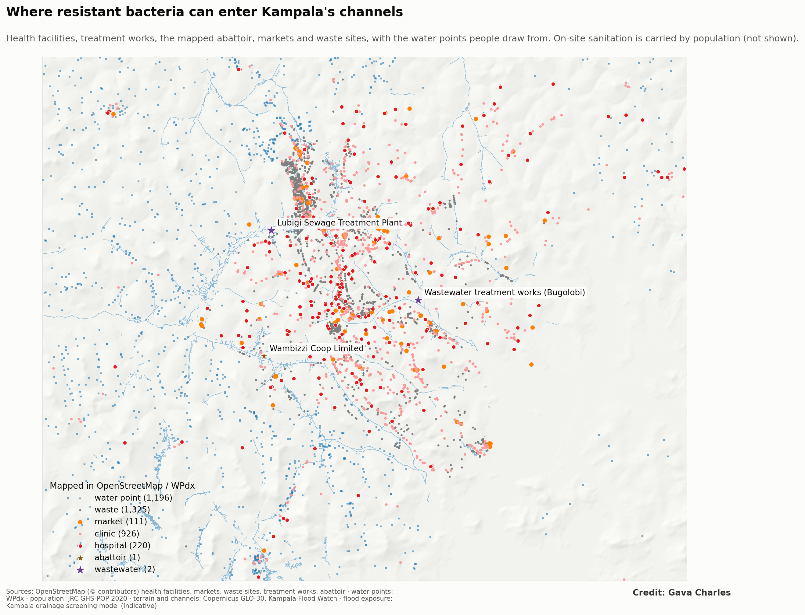
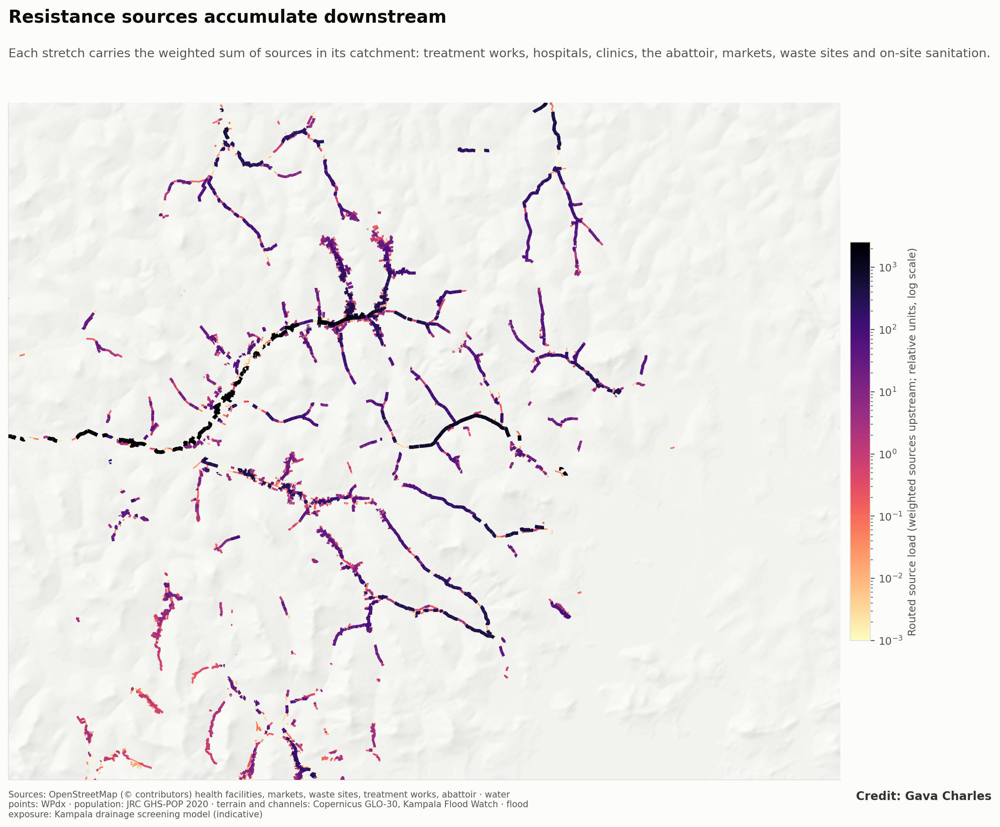
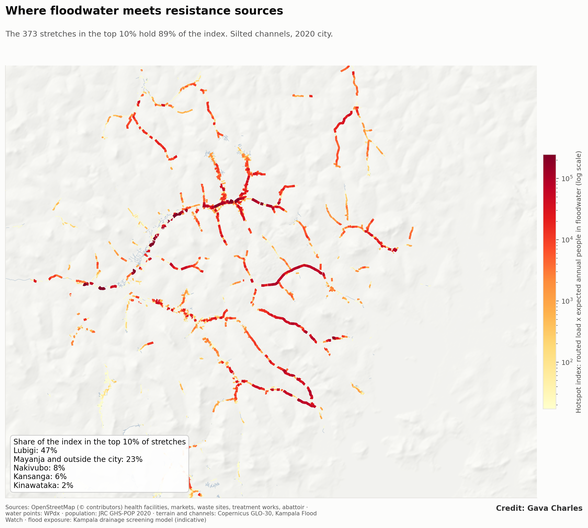
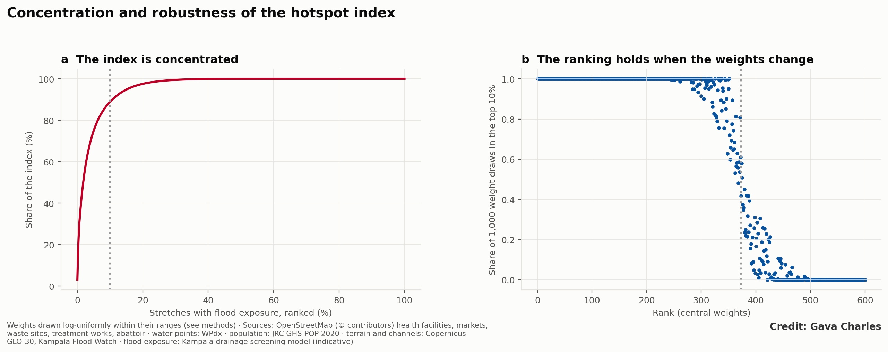
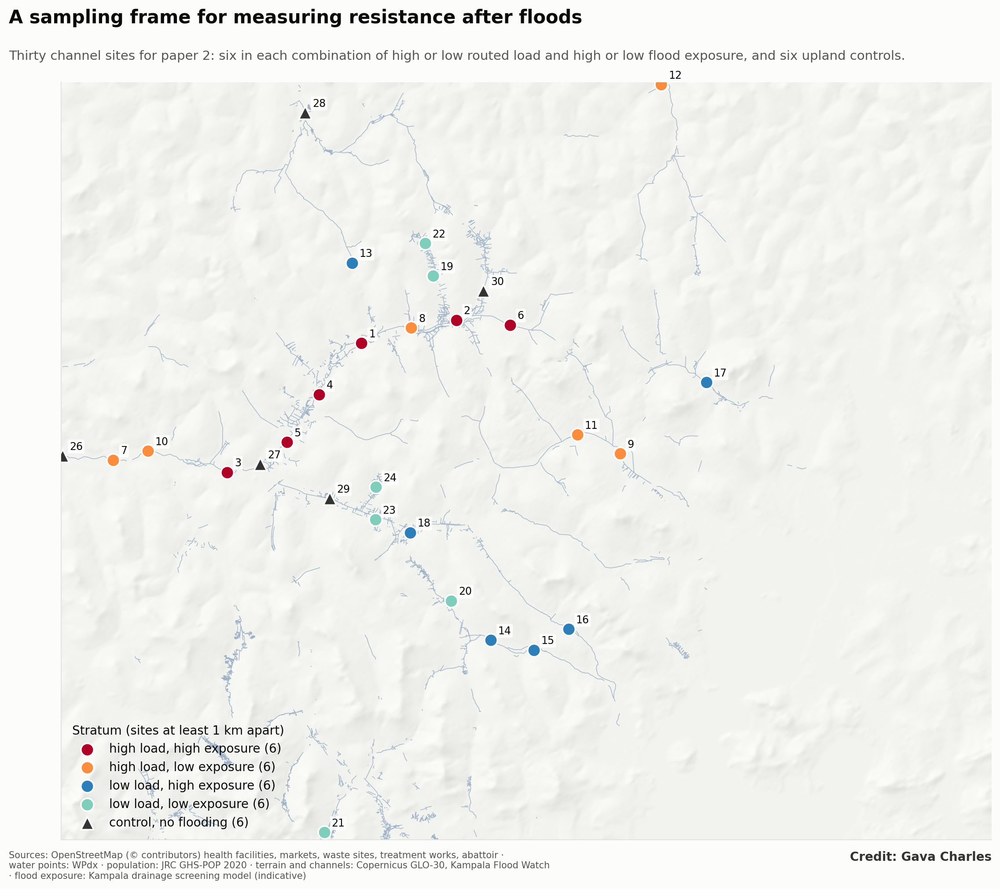
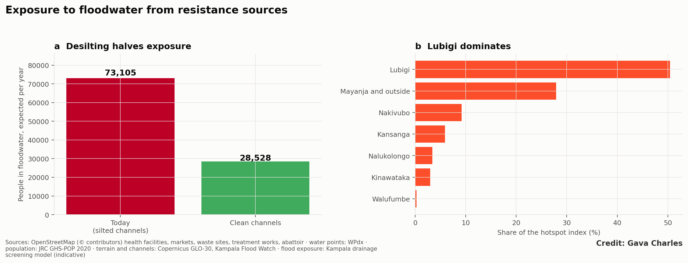
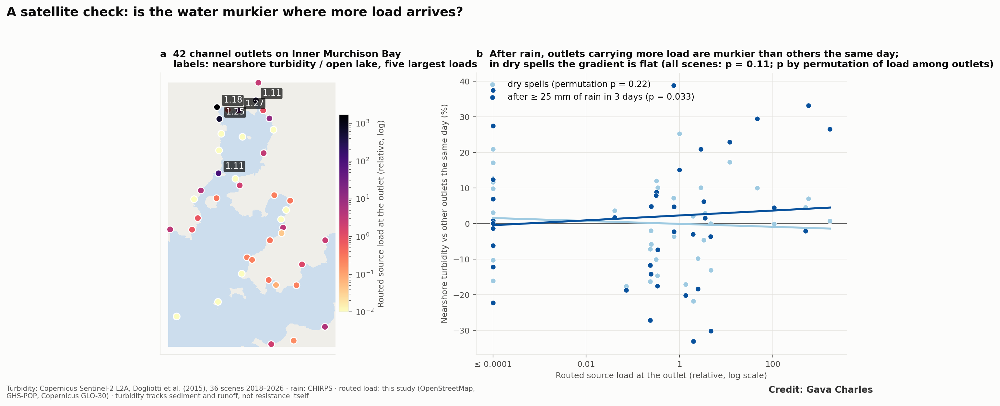

**Paper 6, Kampala drainage programme.** First of two linked papers on floods and antimicrobial resistance (AMR). This paper uses open geospatial data and remote sensing only; paper 7 will measure resistance in the field at the sites selected here.
**Target journals:** *Science of the Total Environment*; *Environment International*; *GeoHealth*; *Environmental Research: Health*.

# Abstract

Floods in African cities carry sewage, latrine contents, hospital effluent and waste into streets and homes. These are the main environmental reservoirs of antibiotic-resistant bacteria and resistance genes, yet where flood paths and resistance sources overlap has not been mapped for any African city. We build an open, reproducible screening of that overlap for Greater Kampala, Uganda.

We inventoried potential sources from open data: 220 hospitals, 926 clinics, two wastewater treatment works, one mapped abattoir, 119 markets and 1,325 waste sites, with on-site sanitation carried by population (GHS-POP). Each source class was routed down a 30 m terrain model to 6,914 channel stretches, and combined with literature-ranked relative weights into a routed source load. Flood exposure came from the Kampala drainage screening model: people, buildings and 2,655 water points on 30 m squares under 10 cm or more of water, integrated over storms from the 2-year to the 100-year event. A hotspot index multiplies routed load by expected annual people exposed.

1. **Exposure is large.** With today's silted channels, about 73,000 people a year are expected to stand in floodwater draining from these sources, and 153,000 in a 10-year storm.
2. **It is concentrated.** The top 10% of exposed stretches (373) hold 89% of the index. The Lubigi system alone holds half, and the Mayanja downstream of it a further 28%.
3. **The ranking is robust.** 349 of the 373 top stretches stay in the top 10% in at least 80% of 1,000 random weightings. The top 10% is unchanged without the treatment works, and 85–89% the same when only health facilities or only sanitation are counted.
4. **Maintenance cuts exposure by more than half.** Clean channels reduce expected annual exposure from 73,000 to 29,000 people and the index by 58%.
5. **A satellite check partly supports the load.** At 42 channel outlets on Inner Murchison Bay, in 36 Sentinel-2 scenes, outlets carrying more routed load were murkier than other outlets on the same day after heavy rain (permutation p = 0.03), but not in dry spells (p = 0.22) or across all scenes (p = 0.11).

The result is a map of where resistance in floodwater is most likely to reach people, and a stratified frame of 30 sampling sites for the field study that will test it.

# 1. Introduction

**Antimicrobial resistance is a leading cause of death.** Bacterial AMR was associated with an estimated 4.95 million deaths in 2019 and directly caused 1.27 million, with the highest rates in sub-Saharan Africa (Murray et al., 2022). Most attention goes to hospitals and antibiotic use. The environment also matters: sewage, wastewater treatment works, hospital effluent and animal waste carry resistant bacteria and resistance genes into rivers and soils, where people meet them again (Berendonk et al., 2015; Larsson and Flach, 2022). Treatment works are recognised hotspots (Rizzo et al., 2013; Karkman et al., 2018), and urban sewage carries a resistance signature that differs between regions (Hendriksen et al., 2019).

**Floods connect these reservoirs to people.** Urban floodwater carries faecal pathogens at concentrations that pose infection risks to people who wade through it (ten Veldhuis et al., 2010; de Man et al., 2014). In cities where most people rely on pit latrines and septic tanks, and where channels run through dense settlements and past markets and waste dumps, a flood mobilises the whole faecal and clinical load of a catchment and spreads it across valley floors where people live.

**Kampala is a clear case.** The city's channels drain hillsides where most households use on-site sanitation, past more than a thousand health facilities, markets and waste sites, to Inner Murchison Bay, the source of most of the city's drinking water. Earlier papers in this programme showed that Kampala's floods are made mainly by encroachment, constrictions, lost wetland and silted channels rather than heavier rain (papers 1 and 4), that hundreds of thousands of people now live on the valley floors (paper 3), and that the wetlands which once cleaned the water draining to the bay have halved (paper 2).

**What is missing is a map of where floodwater and resistance sources meet.** Field studies of AMR in African urban water are few and sample where access is easy; exposure studies of floods rarely consider what the water carries. We ask:
1. Where do potential sources of resistance lie in the path of floodwater?
2. How many people, buildings and water points are exposed, and how concentrated is that exposure?
3. How robust is the ranking to the large uncertainty in how much each source contributes?
4. How much would channel maintenance reduce exposure?
5. Where should a field study sample to test the map?

# 2. Study area

Greater Kampala lies on hills between Lake Victoria and the papyrus valleys of the Lubigi, Nsooba, Nakivubo, Kinawataka, Kansanga, Nalukolongo and Walufumbe systems (Figure 1). Most channels drain south to Inner Murchison Bay; the Lubigi drains west through its wetland to the Mayanja River. Sewer coverage is low and concentrated in the centre; two treatment works, at Bugolobi (Nakivubo) and Lubigi, receive sewage and faecal sludge. Rain comes in two seasons, and heavy storms are short afternoon and night-time convective events.

# 3. Data and methods

## 3.1 Sources

Point sources were taken from OpenStreetMap (Table 1): hospitals and clinics (amenity or healthcare tags), markets, waste disposal sites, transfer stations and landfills, wastewater treatment works and abattoirs. Treatment works mapped as many buildings (tanks, filters) were merged into one plant within 500 m. Duplicate nodes and buildings of the same facility within 30 m were removed. On-site sanitation was represented by resident population (JRC GHS-POP, about 90 m, 2020 and 1990), per 1,000 people.

**Table 1. Sources and receptors.**

| Class | Count in the study area | Source |
|---|---|---|
| Hospitals | 220 | OpenStreetMap |
| Clinics and doctors | 926 | OpenStreetMap |
| Wastewater treatment works | 2 (Bugolobi, Lubigi) | OpenStreetMap |
| Abattoirs | 1 (Wambizzi) | OpenStreetMap |
| Markets | 119 | OpenStreetMap |
| Waste sites | 1,325 | OpenStreetMap |
| On-site sanitation | population | JRC GHS-POP |
| Water points (receptors) | 2,655 | Water Point Data Exchange |

## 3.2 Routing

Each source class was placed on the 30 m Copernicus GLO-30 terrain grid and accumulated downstream along D8 flow directions after filling pits and depressions (pysheds), as for the runoff load in paper 1. Because accumulation is linear, each class was routed once. Each of the 6,914 channel stretches takes the routed values at its downstream-most point, giving the number of sources of each class upstream, A_c.

The routed source load of stretch k is

L_k = Σ_c w_c · A_c(k)

with relative weights w_c: treatment works 50, hospitals 10, abattoir 5, clinics 2, markets 1, waste sites 0.5 and 1 per 1,000 residents for sanitation. The weights rank expected loads of resistant faecal bacteria and resistance genes: treated and untreated wastewater and hospital effluent are the richest sources in the literature, followed by animal slaughter waste and dispersed human faecal sources. They are not measured concentrations, and Section 3.5 tests how much they matter.

## 3.3 Exposure

Flood exposure comes from the Kampala drainage screening model (papers 1 and 4). For each stretch and each design storm (2, 5, 10, 25, 50 and 100 years), the model gives the overbank water level from the stretch's rating curve built on the height of every 30 m square above its drain (HAND). A square is flooded when the water level exceeds its height by 10 cm or more, about a doorstep. On each flooded square we counted residents (GHS-POP shared over its 30 m squares), building footprints (Microsoft Global ML Building Footprints) and water points (WPdx). Expected annual exposure integrates these counts over annual exceedance probability, with the 100-year value held beyond.

Three states were run: today (2020 paving, channels silted to 30% of their depth), clean channels (2020 paving, full capacity) and the 1990 city (1990 paving and population, channels at design capacity).

## 3.4 Hotspot index

H_k = (L_k / median L) · E_k

where E_k is the expected annual number of people in floodwater on stretch k. The index is high where much of the catchment's source load passes and where many people are flooded.

## 3.5 Robustness

- **Weights.** 1,000 draws of all weights, each log-uniform within its range (treatment works 20–100, hospitals 5–20, abattoir 2–10, clinics 1–4, markets 0.5–2, waste 0.2–1, sanitation 0.5–2). For each stretch we record the share of draws in which it is in the top 10%.
- **Structure.** Overlap of the top 10% with five variants: without treatment works; health facilities only; sanitation only; exposure counted as buildings; clean channels.

## 3.6 Satellite check at the bay

Routed load is a model quantity. As an independent check, we asked whether lake water off the channel outlets that carry more load is murkier. Outlets were land cells within 60 m of the open water of Inner Murchison Bay (the water mask of paper 2) where flow accumulation is at least 0.25 km²; cells within 400 m form one outlet, giving 42 outlets. In each of 36 cached Sentinel-2 L2A scenes (2018–2026), we took the median turbidity (Dogliotti et al., 2015) of open-water pixels within 400 m of each outlet, divided by the median of the open-lake reference zone in the same scene; outlets with fewer than 20 valid pixels in a scene were skipped. Rain is CHIRPS over Kampala in the three days before each scene; scenes with 25 mm or more are wet.

Two tests: (1) across outlets, Spearman correlation of the mean log ratio with log routed load; (2) within scenes, the slope of log ratio on log(1 + load) after removing each scene's mean, for all, dry and wet scenes. Because outlet-days are not independent, p-values come from permuting routed load among the 40 outlets with at least five usable scenes, 2,000 times. Turbidity measures sediment and runoff, not resistance: the test asks whether routed load marks where catchment discharge reaches the lake, not whether resistance does.

## 3.7 Sampling frame

Stretches with flood exposure were split at the median into high or low routed load and high or low exposure. In each of the four strata, and among upland stretches without flood exposure (controls), we selected the six highest-ranked stretches at least 1 km from every other selected site, giving 30 sites for paper 7.

# 4. Results

## 4.1 Sources and routed load

Sources are dense in the centre and along the main roads (Figure 1). Routed load rises downstream, steeply where channels pass through the dense northern and central settlements (Figure 2). The highest loads are on the lower Lubigi and the Mayanja below it, which receive the Lubigi treatment works, the north-western hospitals and clinics, and the largest residential catchments; then the Nakivubo, through the centre and past the Bugolobi works.

## 4.2 Exposure

With today's silted channels, about **73,000 people a year** are expected to be in floodwater on stretches carrying these sources, together with about 5,400 buildings a year. In a 10-year storm, 153,000 people and 35 water points are flooded. Few mapped water points stand on the valley floors (17 a year expected), but those that do are protected springs and wells used by the poorest households.

## 4.3 Hotspots

The index is strongly concentrated (Figures 3 and 4a). The **top 10% of exposed stretches (373) hold 89% of the index** but only 36% of exposed people: they are where large exposure and large upstream load coincide. By system, the Lubigi holds 50% of the index, the Mayanja and other catchments outside the city 28%, the Nakivubo 9%, the Kansanga 6%, and the Nalukolongo and Kinawataka 3% each (Figure 6b).

## 4.4 Robustness

**The ranking survives the weight uncertainty** (Figure 4b): 349 of the 373 top stretches are in the top 10% in at least 80% of the 1,000 weightings. Structural variants change little (Table 2). Removing the treatment works leaves the top 10% unchanged: the hotspots are driven by the dense sanitation and health-facility load of their catchments, not by the plants. Counting only health facilities or only sanitation keeps 89% and 85% of the top stretches. Counting buildings instead of people keeps 64%, because building counts weight commercial areas more.

**Table 2. Overlap of the top 10% of stretches with structural variants.**

| Variant | Overlap with the main top 10% |
|---|---|
| Without treatment works | 100% |
| Health facilities only | 89% |
| Sanitation only | 85% |
| Clean channels | 85% |
| Exposure counted as buildings | 64% |

## 4.5 Maintenance and change

**Clean channels would cut expected annual exposure from 73,000 to 29,000 people** (Figure 6a), buildings from 5,400 to 1,800 a year, and the index by 58%. In a 10-year storm, clean channels would still flood about 99,000 people: maintenance removes most exposure in frequent storms, not in rare ones.

In the 1990 city (1990 paving and population, channels at design capacity), expected annual exposure was about 2,300 people, 3% of today's. This comparison combines more people on the valley floors, more paving and silted channels; papers 3 and 4 separate those drivers for flooding. Health facility counts were held at today's, so the 1990 load is overstated, which makes the comparison conservative.

## 4.6 Sampling frame

The 30 sites (Figure 5) span the four strata and six upland controls. High-load, high-exposure sites lie on the Lubigi and its Nsooba and Kalerwe tributaries; low-load, high-exposure sites on the southern and eastern channels; controls on upland tributaries without flood exposure.

## 4.7 Satellite check

Across outlets, average turbidity relative to the open lake was unrelated to routed load (Spearman ρ = 0.07, p = 0.67): standing differences between outlets reflect shoreline shape, papyrus fringes and depth more than catchment load. Within scenes, outlets with more routed load were slightly murkier than other outlets on the same day, and the gradient appears after rain: the within-scene slope was positive after 25 mm or more in three days (permutation p = 0.033), flat in dry spells (p = 0.22), and not significant across all scenes (p = 0.11) (Figure 7). The pattern is what routed load should produce if it marks where catchment discharge reaches the lake during runoff; the effect is small and rests on 371 wet outlet-days.

# 5. Discussion

**Where the risk is.** Exposure to floodwater carrying resistance sources is not spread across Kampala. It is concentrated on a few hundred stretches of the Lubigi, the Mayanja downstream of it, and the Nakivubo, where dense unsewered settlements and many health facilities drain into channels that flood the homes beside them. These are also the channels that earlier papers ranked highest for maintenance and for people on low ground: the same places carry the flood, the people and the load.

**Why the ranking is credible despite uncertain weights.** No one has measured the resistance load of each source class in Kampala, so the weights are informed guesses. The ranking does not depend much on them: it holds across 1,000 weightings, without the treatment works, and with only one source class at a time. What drives it is geography: where many sources and many flooded people share a catchment, the product is high under any reasonable weighting.

**Maintenance as a public-health measure.** Desilting is usually justified by roads and property. This analysis adds a health argument: clean channels would remove more than half of the expected exposure to floodwater from these sources. The cheapest flood measure in Kampala is also an AMR measure.

**Water supply.** Most flooded water points are protected springs and shallow wells on valley floors, used by households without piped water. They are few in the WPdx inventory, which is far from complete in Kampala, but each one flooded is a direct route from floodwater to drinking water. Downstream, the channels that rank highest to the south discharge to Inner Murchison Bay above the Ggaba intake, where paper 2 found the water at channel outlets growing murkier relative to the open lake as the wetlands shrank.

**An independent signal.** The satellite check is weak but points the right way: after heavy rain, outlets carrying more routed load are murkier than other outlets the same day. Turbidity is not resistance, but it shows that the routing marks where catchment runoff reaches the lake when it rains, which is when floodwater is carrying the load.

**What the map cannot say.** It does not measure resistance. It ranks where resistance in floodwater is most likely to reach people, given where sources and floods are. Whether floods raise resistant bacteria and resistance genes in water, on surfaces and in people's guts, by how much and for how long, needs measurement. The sampling frame is designed for that: if the index is right, concentrations after floods will rise with routed load, and carriage will rise with exposure hours.

# 6. Limitations

- **Source inventory.** OpenStreetMap is incomplete in Kampala. Only one abattoir is mapped (the City Abattoir is not), sewer overflows and septage dumping sites are not mapped, and many small clinics, drug shops and livestock keepers are missing. Pharmacies were not used as sources.
- **Sanitation.** Population stands in for on-site sanitation everywhere; sewered areas in the centre are therefore overweighted. Parish-level sanitation data from the census would improve this.
- **Weights.** Relative, literature-informed and untested in Kampala; the robustness tests bound their effect on the ranking but not on absolute exposure.
- **Routing.** Sources are routed with the terrain, not through sewers, storm drains or pipes. Decay, settling and wetland removal of bacteria and genes are not modelled: the load is a potential, not a concentration.
- **Floods.** The screening model has no surveyed channels or culverts and no surface water away from channels; depths are indicative (papers 1 and 4). Short local storms are underrepresented.
- **Receptors.** GHS-POP is modelled population; WPdx covers only part of Kampala's springs and wells.

# 7. Conclusion

Floodwater in Kampala passes through dense unsewered settlements, past more than a thousand health facilities, markets and waste sites, and into the homes of people on the valley floors. An open, reproducible screening shows where this matters most: a few hundred stretches, mainly the Lubigi, the Mayanja and the Nakivubo, hold nine-tenths of the hotspot index, and the ranking holds under wide uncertainty in source weights. Clean channels would halve the exposure. The 30-site frame provided here turns the map into a field test of whether floods carry resistance to people.

# Data and code

Open data only. Code: `src/am_sources.py` (inventory), `src/am_index.py` (routing, exposure, index, robustness, sampling frame), `src/am_figs.py` (figures and variants), `src/am_satcheck.py` (satellite check). Results: `results/am_stretches.csv`, `results/am_summary.csv`, `results/am_variants.csv`, `results/am_sampling_frame.csv`, `results/am_satcheck_outlets.csv`, `results/am_satcheck_tests.csv`.

# References

*Verify each reference against the source before submission.*

Berendonk, T. U., Manaia, C. M., Merlin, C., et al. (2015). Tackling antibiotic resistance: the environmental framework. *Nature Reviews Microbiology*, 13, 310–317.

de Man, H., van den Berg, H. H. J. L., Leenen, E. J. T. M., et al. (2014). Quantitative assessment of infection risk from exposure to waterborne pathogens in urban floodwater. *Water Research*, 48, 90–99.

Dogliotti, A. I., Ruddick, K. G., Nechad, B., Doxaran, D., and Knaeps, E. (2015). A single algorithm to retrieve turbidity from remotely-sensed data in all coastal and estuarine waters. *Remote Sensing of Environment*, 156, 157–168.

Gillings, M. R., Gaze, W. H., Pruden, A., et al. (2015). Using the class 1 integron-integrase gene as a proxy for anthropogenic pollution. *The ISME Journal*, 9, 1269–1279.

Government of Uganda (2018). *Antimicrobial Resistance National Action Plan 2018–2023*. Kampala.

Hendriksen, R. S., Munk, P., Njage, P., et al. (2019). Global monitoring of antimicrobial resistance based on metagenomics analyses of urban sewage. *Nature Communications*, 10, 1124.

Karkman, A., Do, T. T., Walsh, F., and Virta, M. P. J. (2018). Antibiotic-resistance genes in waste water. *Trends in Microbiology*, 26, 220–228.

Larsson, D. G. J., and Flach, C.-F. (2022). Antibiotic resistance in the environment. *Nature Reviews Microbiology*, 20, 257–269.

Murray, C. J. L., Ikuta, K. S., Sharara, F., et al. (2022). Global burden of bacterial antimicrobial resistance in 2019: a systematic analysis. *The Lancet*, 399, 629–655.

Rizzo, L., Manaia, C., Merlin, C., et al. (2013). Urban wastewater treatment plants as hotspots for antibiotic resistant bacteria and genes spread into the environment: a review. *Science of the Total Environment*, 447, 345–360.

ten Veldhuis, J. A. E., Clemens, F. H. L. R., Sterk, G., and Berends, B. R. (2010). Microbial risks associated with exposure to pathogens in contaminated urban flood water. *Water Research*, 44, 2910–2918.

World Health Organization (2021). *WHO integrated global surveillance on ESBL-producing E. coli using a "One Health" approach: implementation and opportunities*. Geneva.

*To add after a literature search: published measurements of resistant bacteria and resistance genes in Kampala's channels, wetlands and Murchison Bay; JRC GHS-POP; Copernicus DEM; Microsoft building footprints; WPdx; pysheds; and papers 1–4 of this programme.*

# Figures

{width=100%}

{width=100%}

{width=100%}

{width=100%}

{width=100%}

{width=100%}

{width=100%}
