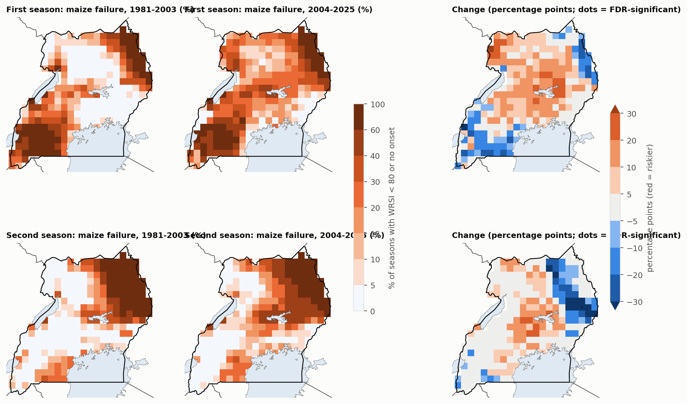
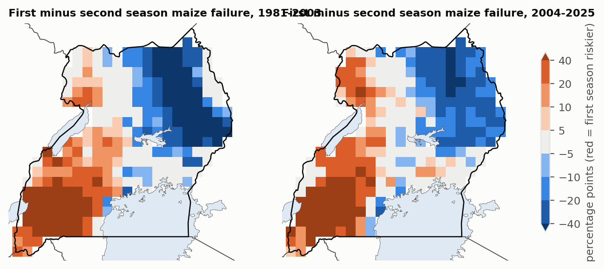
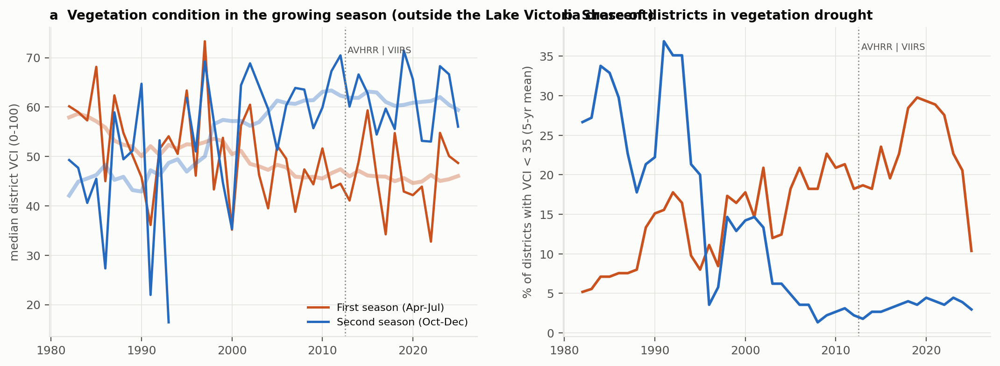
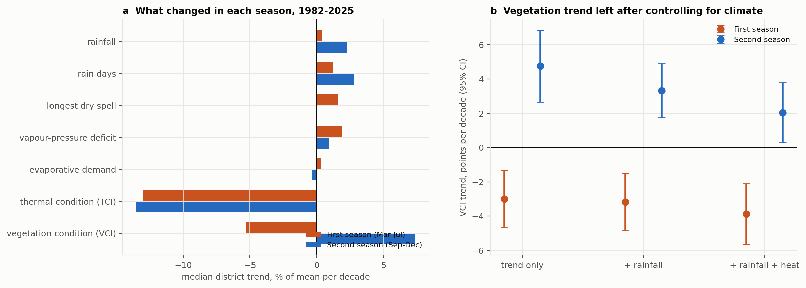

# Divergent satellite rainfall and vegetation signals of growing-season change in Uganda, 1981–2025

Gavamukulya Charles · Draft manuscript · 8 October 2026

## Abstract

Farmers and planners in Uganda report that the March–May rains have become less dependable and the September–December rains more so. Whether this is true depends on which satellite record you ask.

**Rainfall-based assessment.** We computed a crop water-balance index (WRSI) for maize and beans from two satellite–gauge rainfall datasets (CHIRPS 1981–2025, ARC2 1983–2025), each with two definitions of season onset. Only a few changes keep the same sign in all four combinations:
- lower failure risk in Karamoja, in the north's second season and in the south-west's first season;
- higher risk in the first season of the West Nile–Lango–Teso belt;
- almost no grid-cell change survives a false-discovery-rate test.

**Vegetation-based assessment.** Satellite vegetation condition over cropland (NOAA VHP VCI, 1982–2025), outside the urbanising Lake Victoria crescent, shows a clear swap:
- first-season vegetation drought rose from 11% to 23% of district-seasons;
- second-season drought fell from 21% to 3%;
- the shift appears before the 2013 sensor change.

**Why they disagree.** A district fixed-effects panel shows the second-season improvement is largely climatic: rainfall and rain days increased, and climate covariates explain about 57% of the vegetation trend. The first-season decline is not. Rainfall, dry spells and heat barely changed, and the vegetation trend persists after controlling for them (−3.0 to −3.9 VCI points per decade). It is strongest at the peak of the season (late April–May).

**Outcomes.** Rainfall-based indices track vegetation weakly (r = 0.12–0.26) and national yields not at all. Karamoja's IPC Phase 3+ share rose from 0% to 27–38% between 2011–2013 and 2021–2024 while its seasons improved.

**Conclusion.** The weakening first season that farmers describe is real in the vegetation record, but its cause is not in the rainfall. Early-warning and adaptation planning that rely on satellite rainfall alone will miss it.

**Keywords:** growing season; vegetation condition index; WRSI; satellite rainfall; early warning; Karamoja; Uganda

## 1 Introduction

Most of Uganda's food is grown without irrigation, so the timing and reliability of the rains decide harvests. Southern and central Uganda has two seasons, March–May and September–December. The north has one long season with a mid-year dip, and Karamoja a short, unreliable one.

Food insecurity is concentrated where rainfall is least reliable. In April–July 2026 about 473,000 people in Karamoja were in IPC Phase 3 or worse ([Daily Monitor, 4 August 2026](https://www.monitor.co.ug/uganda/news/national/470-000-karamoja-locals-face-acute-food-insecurity-report-5546108)).

Evidence on whether the seasons are changing comes mostly from rainfall. Station analyses show highly variable first-season onset ([Mubiru et al. 2012](https://scielo.org.za/scielo.php?script=sci_arttext&pid=S0038-23532012000200020)). CHIRPS and NDVI show frequent false starts in the north and Karamoja ([Ocen et al. 2021](https://pmc.ncbi.nlm.nih.gov/articles/PMC8637494/)). Regionally, the long rains declined in the eastern Horn after the late 1990s while the short rains became wetter (Lyon and DeWitt 2012; Rowell et al. 2015; Wainwright et al. 2019).

Early-warning systems such as FEWS NET monitor seasons with both satellite rainfall (WRSI, rainfall anomalies) and satellite vegetation (NDVI, VCI). The two are usually assumed to tell the same story at seasonal and multi-decadal scales. We test that assumption for Uganda over 45 years and ask:

1. Do rainfall-based measures (season timing and crop water-stress frequency, from two datasets and two onset definitions) show a change in the reliability of Uganda's two growing seasons?
2. Does satellite vegetation condition show the same change?
3. Where they disagree, what explains the vegetation signal: rainfall amount, within-season dry spells, heat and evaporative demand, or none of these?
4. Which signal relates better to crop yields and food-security outcomes?

## 2 Study area and rainfall regions

We use six rainfall regions defined by k-means clustering of the 1991–2020 CHIRPS annual cycle (269 cells of 0.25°):

| Region | Annual rain 1991–2020 | Regime |
| --- | --- | --- |
| Karamoja | 785 mm | single short season |
| North (Acholi–Kitgum) | 1,256 mm | single long season |
| West Nile–Lango–Teso–Elgon belt | 1,355 mm | single long season, mid-year dip |
| Mid-west & Kyoga | 1,189 mm | two seasons |
| Lake Victoria crescent | 1,400 mm | two seasons |
| South-west (Ankole–Kigezi) | 1,074 mm | two seasons, dry June–August |

Cells are classed as bimodal when the second harmonic of the annual cycle exceeds the first (Dunning et al. 2016).

## 3 Data

| Dataset | Use | Resolution, period | Source |
| --- | --- | --- | --- |
| CHIRPS v2.0 | Daily rainfall | 0.25°, 1981–2025 | [Funk et al. 2015](https://www.nature.com/articles/sdata201566) |
| ARC2 | Second rainfall dataset (merges daily gauge reports differently) | 0.1°, 1983–2025 | NOAA CPC via the [IRI Data Library](http://iridl.ldeo.columbia.edu/SOURCES/.NOAA/.NCEP/.CPC/.FEWS/.Africa/.DAILY/.ARC2/) |
| NASA POWER | Reference evapotranspiration ET0 (FAO-56 Penman–Monteith from daily fields) | 0.5°, 1981–2025 | [power.larc.nasa.gov](https://power.larc.nasa.gov) |
| NOAA STAR VHP | Vegetation Condition Index over cropland, weekly, by district (58 districts in the VHP admin set) | 1982–2025; AVHRR to 2012, VIIRS from 2013 | [NOAA STAR](https://www.star.nesdis.noaa.gov/smcd/emb/vci/VH/index.php) |
| FAOSTAT | National yields (maize, beans, sorghum, millet) | 1961–2024 | [FAO](https://www.fao.org/faostat/) |
| FEWS NET | IPC-compatible phase classifications | 2011–2026 | [FEWS NET Data Warehouse](https://fdw.fews.net) |
| GADM 4.1 | District boundaries matching VHP | vector | [GADM](https://gadm.org) |

## 4 Methods

### 4.1 Season onset and cessation

We computed two onset definitions for every cell, year and season:

- **A, agronomic (planting) onset:** the first day with at least 20 mm in 3 days and no dry spell of 10 or more days (< 1 mm/day) in the following 30 days. The search windows are 15 February–15 May (first season) and 1 August–31 October (second). If no day qualifies, the season counts as failed.
- **B, anomalous accumulation** (Liebmann et al. 2012), for bimodal cells only. Cessation is the maximum of cumulative (rain − mean daily rain) in the window (1 February–31 July or 1 August–31 January). Onset is the day after the preceding minimum. Finding cessation first avoids a spurious late minimum when the following dry season pulls the curve down. Seasons shorter than 20 days count as undefined.

### 4.2 Crop water balance (WRSI)

We followed FAO / FEWS NET GeoWRSI logic (Verdin and Klaver 2002), planting at onset:

| Crop | Duration | Crop coefficient (Kc) | Stages |
| --- | --- | --- | --- |
| Maize | 120 days | 0.3 → 1.2 → 0.6 | 20–35–40–25 days |
| Beans | 90 days | 0.4 → 1.15 → 0.35 | 15–25–35–15 days |

Soil water-holding capacity is 100 mm, with a depletion fraction of 0.5, run as a daily bucket model:

```
WRSI = 100 × Σ AET / Σ (Kc × ET0)
```

Following FEWS NET classes, a season is **water-stressed** if WRSI < 80 (main measure) and **failed** if WRSI < 50 or no onset occurs.

### 4.3 Change detection

For each cell we compared failure frequencies in 1981–2003 and 2004–2025 (ARC2: 1983–2003) with Fisher's exact test, and controlled field significance with the Benjamini–Hochberg false-discovery rate at 10% (Wilks 2016). For each region we averaged failure across cells for each year and tested the change in means by permuting years (2,000 permutations). Timing trends use Sen's slope and the Hamed–Rao modified Mann–Kendall test. A change is called **robust** only if it has the same sign in all four dataset × onset combinations.

### 4.4 Explaining the vegetation signal

For 42 districts outside the Lake Victoria crescent, we built a district × year × season panel (1982–2025) with:
- VCI and TCI (NOAA's thermal condition index);
- rainfall over the season and the preceding month (CHIRPS: March–July and September–December), rain days and the longest dry spell;
- mean Tmax, vapour-pressure deficit and ET0 from NASA POWER daily fields.

We computed Sen trends for each variable and district, and fitted fixed-effects regressions of VCI on a decadal time trend, with and without standardised rainfall and heat covariates. Standard errors are clustered by year. The share of the VCI trend that disappears once covariates are added is the share explained by climate. We also computed VCI trends for sub-windows of the year, to locate the decline within the season.

### 4.5 Validation against outcomes

- **Vegetation:** for each district and season, the mean VCI over weeks 17–28 (first season) or 43–52 (second), correlated with the district-mean maize WRSI. We used Spearman correlations of anomalies within districts, and the frequency of VCI < 35 when WRSI failed.
- **Vegetation as an independent test:** VCI trends and drought frequency by district, 1982–2025. We excluded the 11 Lake Victoria crescent districts where urban growth lowers vegetation readings, and compared 2004–2012 (AVHRR only) with 1982–2003 to rule out a sensor artefact.
- **Yields:** FAOSTAT national yields, detrended as log deviations from a 7-year running median, against national mean WRSI.
- **Food security:** the share of Karamoja's IPC units in Phase 3 or worse (Current Situation, 2011–2026), against the preceding season's WRSI failure share and VCI.

## 5 Results

### 5.1 Season timing has changed little

Most onset, cessation and length trends are small (< 3 days per decade) and not significant. Changes significant in at least one dataset × method combination:

| Region | Change | Evidence |
| --- | --- | --- |
| South-west | First-season onset earlier by about 3 days per decade | CHIRPS-B (p = 0.03); ARC2-A (p = 0.04) |
| Lake Victoria crescent | Second season longer by 5.7 days per decade | CHIRPS-B (p < 0.01) |
| Lake Victoria crescent | Second-season onset earlier by 5 days per decade | ARC2-B (p = 0.03) |
| Karamoja | Second-season cessation later by 7.7 days per decade | ARC2 (p < 0.01) |

Season timing varies by several weeks from year to year, far more than any trend.

### 5.2 Water-stressed seasons: few robust changes

Maize, WRSI < 80, change in percentage points between 1981–2003 and 2004–2025:

| Region | First season, CHIRPS A / B | First season, ARC2 A / B | Second season, CHIRPS A / B | Second season, ARC2 A / B | Robust? |
| --- | --- | --- | --- | --- | --- |
| Karamoja | −10.5 / n.a. | −4.3 / −5.9 | −5.4 / n.a. | −0.4 / −2.2 | lower risk |
| North (Acholi–Kitgum) | +7.9 / n.a. | +3.9 / +8.5 | −10.2 / n.a. | −9.8 / −14.0 | lower 2nd-season risk |
| West Nile–Lango–Teso–Elgon | +14.1* / +12.5 | +1.3 / +6.8 | +5.0 / +3.0 | −3.4 / −9.8 | higher 1st-season risk |
| Mid-west & Kyoga | +6.8 / +6.0 | −8.4 / −8.0 | +6.2 / +4.3 | +0.7 / −0.1 | datasets disagree |
| Lake Victoria crescent | +6.2 / +2.2 | −8.0 / −1.7 | +4.2 / −4.2 | +2.0 / −8.0 | datasets disagree |
| South-west | −8.2 / −13.8 | −23.6* / −20.2* | −0.8 / −1.5 | −1.9 / −2.4 | lower 1st-season risk |

\* p < 0.05 (permutation test). n.a. = method B not defined (single-season region). A = agronomic onset; B = anomalous accumulation.

The probability of a water-stressed first season in 2004–2025 is about 31% nationally in both datasets, against 27% (CHIRPS) and 36% (ARC2) for the second season. At the grid-cell level, no more than 2% of cells in any region show an FDR-significant change in maize water stress. Results for beans and for the stricter WRSI < 50 are in `results/fp_failure_zone.csv`.



**Figure 1.** Maize water-stress frequency (WRSI < 80 or no onset), CHIRPS, agronomic onset: 1981–2003, 2004–2025 and the change. Dots mark FDR-significant cells.



**Figure 2.** First minus second season failure frequency (red = first season riskier), 1981–2003 and 2004–2025.

### 5.3 Vegetation shows a clear shift from the first to the second season

Satellite vegetation condition, independent of rainfall data, shows the shift that rainfall-based indices only hint at:

| | 1982–2003 | 2004–2012 (AVHRR only) | 2013–2025 |
| --- | --- | --- | --- |
| First season: median district VCI | 53 | 46 | 46 |
| First season: districts in vegetation drought | 11% | 21% | 23% |
| Second season: median district VCI | 50 | 61 | 61 |
| Second season: districts in vegetation drought | 21% | 4% | 3% |

Districts outside the Lake Victoria crescent; drought = VCI < 35.

Including all 55 districts, first-season VCI declined significantly (p < 0.05) in 58% of districts, with a median trend of −3.9 per decade. Second-season VCI rose significantly in 42%. The shift had already appeared by 2004–2012, before the 2013 change from AVHRR to VIIRS, so it is not a sensor artefact.

The Lake Victoria crescent districts (Kampala, Wakiso, Jinja, Mukono and neighbours) decline in both seasons, consistent with cropland lost to building rather than with rainfall.



**Figure 3.** (a) Median district vegetation condition in the first (orange) and second (blue) growing season, outside the Lake Victoria crescent. (b) Share of districts in vegetation drought (5-year running mean). The dotted line marks the AVHRR-to-VIIRS change.

### 5.4 Climate explains the second-season gain, not the first-season loss

Median district trends per decade, 1982–2025 (42 districts):

| Variable | First season | Second season |
| --- | --- | --- |
| VCI | −2.6 points (50% of districts significantly down) | +4.1 points (55% significantly up) |
| TCI (thermal condition) | −5.9 (81% down) | −5.8 (71% down) |
| Rainfall | +0.4% | +2.3% (31% significantly up) |
| Rain days | +1.3% | +2.8% (55% significantly up) |
| Longest dry spell | +1.6% (none significantly up) | 0% |
| Vapour-pressure deficit | +1.9% | +0.9% |
| Evaporative demand (ET0) | +0.3% | −0.3% |

In the second season, the vegetation gain matches more rain and more rain days. In the first season, rainfall, dry spells and evaporative demand barely changed, yet vegetation declined. Both seasons show falling TCI, meaning warmer canopy temperatures.

VCI trend in the fixed-effects panel, in points per decade (95% interval):

| Season | Trend only | + rainfall | + rainfall and heat |
| --- | --- | --- | --- |
| First | −3.0 (±1.7) | −3.2 (±1.7) | −3.9 (±1.8) |
| Second | +4.8 (±2.1) | +3.3 (±1.6) | +2.0 (±1.8) |

Climate covariates explain about 57% of the second-season trend and none of the first-season trend. Rainfall is a significant predictor of first-season VCI (p = 0.02), but it has not trended. Within the year, the decline is concentrated at the peak of the first season:

| Window | Median VCI trend per decade | Districts significantly down |
| --- | --- | --- |
| March–April | −0.7 | 9% |
| Late April–May | −3.1 | 50% |
| June–mid July | −2.8 | 39% |
| Mid July–August | −1.5 | 34% |
| September–October | +2.1 | 9% (41% up) |
| November–December | +3.3 | 0% (52% up) |

A shift to earlier harvests would mainly lower June–July greenness, so the peak-season decline argues against that explanation.



**Figure 4.** (a) Median district trends in vegetation, thermal condition and climate variables by season. (b) VCI trend left after controlling for rainfall and heat.

### 5.5 How well do rainfall-based failures explain outcomes?

**Vegetation.** Maize WRSI and growing-season VCI are positively but weakly related:

| Season | CHIRPS, pooled Spearman r | ARC2, pooled Spearman r |
| --- | --- | --- |
| Second | 0.26 | 0.22 |
| First | 0.12 | 0.01 (not significant) |

When at least half a district's cells failed, VCI drought followed in 30–36% of seasons (CHIRPS), against 15–20% otherwise.

**Yields.** Detrended FAOSTAT national yields of maize, beans, sorghum and millet show no relation with national WRSI (|r| ≤ 0.15, all p > 0.3). National statistics in Uganda are partly modelled and mix two seasons and many regions, so this is a weak test.

**Food security in Karamoja.** The share of Karamoja IPC units in Phase 3 or worse rose from 0% in 2011–2013 to 27–38% in 2021–2024. Over the same years, Karamoja's crop water stress fell and its vegetation condition improved. IPC status is unrelated to the preceding season's WRSI failure (r = 0.10 with CHIRPS, −0.18 with ARC2, not significant). Its weak positive correlation with VCI (r = 0.31) reflects two opposite trends, not a causal link.

## 6 Discussion

### 6.1 Two satellites, two stories

Rainfall-based assessments of Uganda's growing seasons, from two datasets and two onset definitions, find few robust changes. The vegetation record finds a clear one: the first season is weakening and the second strengthening. The second-season gain is consistent with the observed wetting of the East African short rains, and rainfall-based measures partly capture it.

The first-season loss is a different kind of change. It sits at the peak of the season, persists after controlling for rainfall, dry spells, heat and evaporative demand, and appears before the satellite sensor change. Three explanations remain:

- **Land-cover and land-use change:** clearing woody vegetation and fallow, continuous cropping and soil degradation. These lower peak-season greenness without any change in rain. Uganda's tree cover and cropland have changed substantially since the 1990s, and a land-cover time series could test this.
- **Rainfall features the products miss:** the timing of rain within the season, or storms too small for satellite rainfall to resolve. CHIRPS and ARC2 disagree on several first-season changes, which shows how uncertain the rainfall record is.
- **Measurement:** VCI is relative to each district's own range, and a seasonal bias in the AVHRR record cannot be ruled out entirely, although the pre-2013 shift and the opposite second-season trend make a simple artefact unlikely.

Whichever explanation holds, the practical point is the same. Farmers' experience of a less reliable first season is real in the vegetation record, but satellite rainfall alone would not detect it.

### 6.2 Rainfall is not the main driver of recent food insecurity in Karamoja

Karamoja's IPC classifications worsened sharply after 2018, while its growing seasons became, if anything, more favourable. This is consistent with assessments that cite livestock losses, insecurity, pests and prices alongside climate. Early-warning systems that lean on rainfall-based crop indices would have missed this deterioration.

### 6.3 Limitations

- CHIRPS and ARC2 have changing gauge inputs; neither is calibrated to Ugandan stations here.
- The WRSI uses fixed crop parameters and soil water-holding capacity, and one planting rule.
- VHP districts follow the 58-district map of the early 2000s.
- VCI measures vegetation greenness and temperature, not yield.
- FAOSTAT yields are national. IPC classifications start in 2011, and our unit-share measure ignores population.

## 7 Implications

1. **Monitoring and early warning.** Treat rainfall-based crop indices and vegetation indices as complementary, not interchangeable. In Uganda they diverge on the multi-decadal trend that matters most for planning. Rainfall-based WRSI alone explains little crop or food-security variation.
2. **Planting advice.** In the north, the West Nile–Lango–Teso belt and much of the bimodal south, the second season is now at least as reliable as the first. Extension services should stop treating March–May as the default main season.
3. **Look beyond rainfall for the first-season decline.** Soil fertility, land cover and cropping practices may matter more than rain for the March–July season. Soil and water conservation, agroforestry and fallow management are candidate responses alongside drought-tolerant, short-cycle varieties.
4. **Karamoja.** The recent rise in acute food insecurity happened in improving seasons, so responses must go beyond climate.
5. **Data.** Subnational, season-specific crop statistics (UBOS), UNMA station rainfall and a consistent land-cover time series would allow the explanations above to be separated.

## 8 Conclusions

- Two satellite rainfall datasets show few robust changes in the timing or crop water-stress risk of Uganda's growing seasons since 1981.
- Satellite vegetation shows a clear swap: first-season vegetation drought doubled and second-season drought nearly disappeared, independent of urbanisation and sensor change.
- Climate explains the second-season improvement (more rain, more rain days) but not the first-season decline, which is strongest at the peak of the season and persists after controlling for rainfall and heat.
- Rainfall-based crop indices track vegetation weakly and national yields not at all. Karamoja's worsening food insecurity since 2018 is not explained by rainfall.

## Data and code availability

Code: `src/food_paper.py` (seasons, WRSI, change tests, validation), `src/food_divergence.py` (panel and trends), `src/food_vci_figure.py`, `src/fetch_food.py`, `src/fetch_kampala.py` (ARC2). Tables: `results/fp_*.csv`. Data are public (section 3).

## References

1. Dunning, C. M., Black, E. C. L. and Allan, R. P. (2016). The onset and cessation of seasonal rainfall over Africa. *Journal of Geophysical Research: Atmospheres* 121.
2. Funk, C. et al. (2015). The climate hazards infrared precipitation with stations. *Scientific Data* 2, 150066.
3. Kogan, F. N. (1995). Application of vegetation index and brightness temperature for drought detection. *Advances in Space Research* 15.
4. Liebmann, B. et al. (2012). Seasonality of African precipitation from 1996 to 2009. *Journal of Climate* 25.
5. Lyon, B. and DeWitt, D. G. (2012). A recent and abrupt decline in the East African long rains. *Geophysical Research Letters* 39.
6. Mubiru, D. N. et al. (2012). Characterising agrometeorological climate risks and uncertainties: crop production in Uganda. *South African Journal of Science* 108.
7. Novella, N. S. and Thiaw, W. M. (2013). African Rainfall Climatology version 2 for famine early warning systems. *Journal of Applied Meteorology and Climatology* 52.
8. Ocen, E., de Bie, C. A. J. M. and Onyutha, C. (2021). Investigating false start of the main growing season: a case of Uganda in East Africa. *Heliyon* 7, e08428.
9. Rowell, D. P. et al. (2015). Reconciling past and future rainfall trends over East Africa. *Journal of Climate* 28.
10. Verdin, J. and Klaver, R. (2002). Grid-cell-based crop water accounting for the famine early warning system. *Hydrological Processes* 16.
11. Wainwright, C. M. et al. (2019). 'Eastern African Paradox' rainfall decline due to shorter not less intense Long Rains. *npj Climate and Atmospheric Science* 2.
12. Wilks, D. S. (2016). "The stippling shows statistically significant grid points": how research results are routinely overstated and overinterpreted. *Bulletin of the American Meteorological Society* 97.
13. Daily Monitor (2026). 470,000 Karamoja locals face acute food insecurity – report. 4 August 2026.
