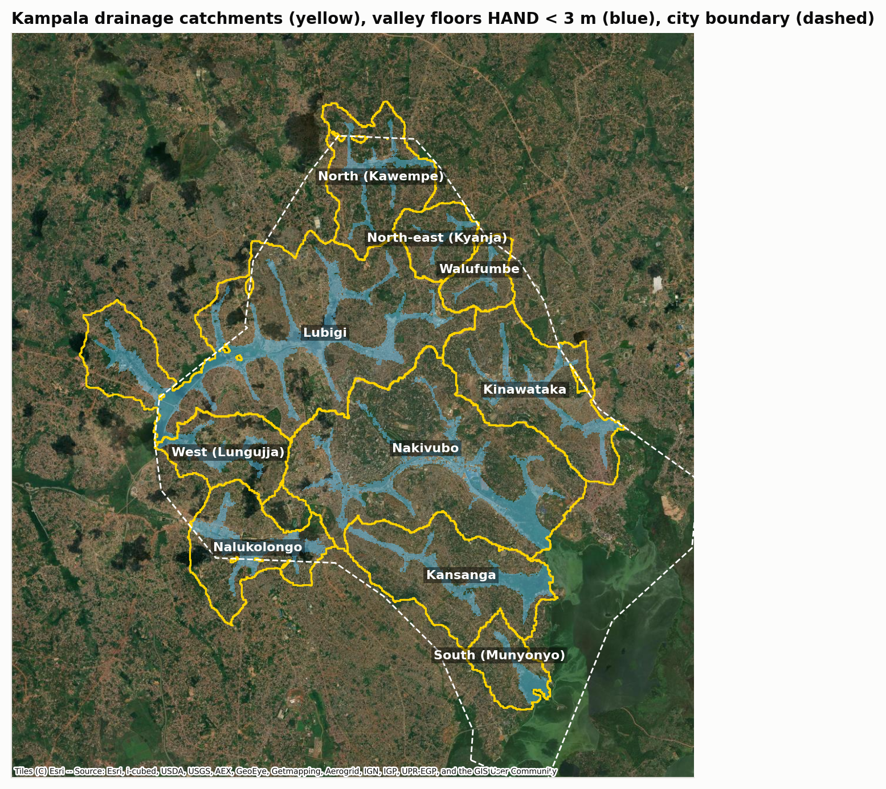
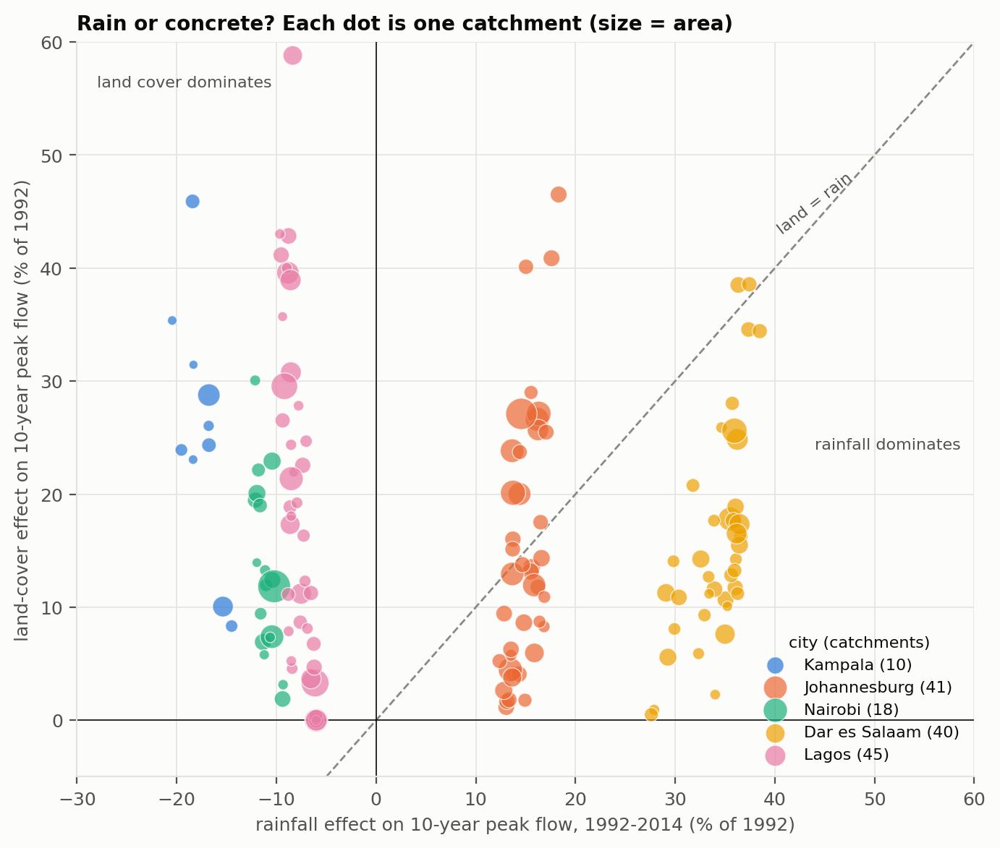
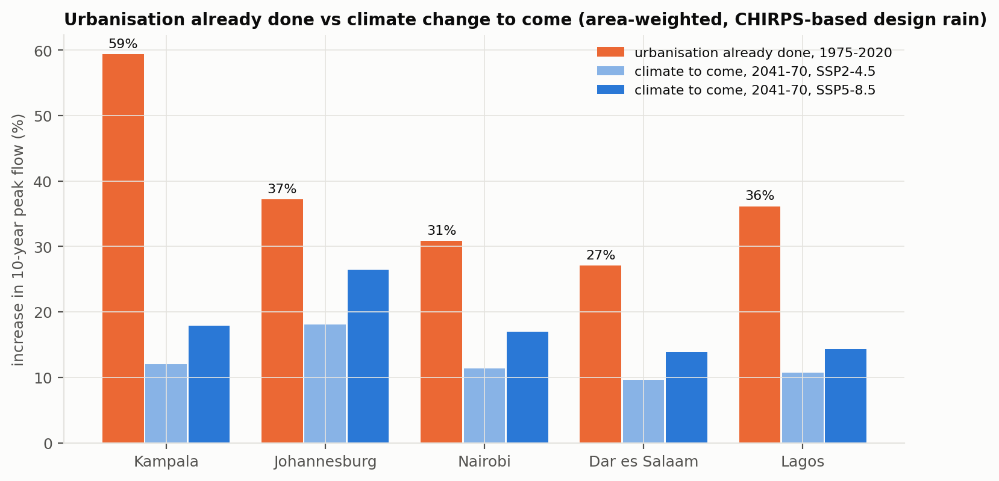

# Quantifying land-cover change and climate change as drivers of urban flood peaks in Kampala, Nairobi, Dar es Salaam, Lagos and Johannesburg

Gavamukulya Charles · Draft manuscript · 8 October 2026

## Abstract

Flood risk in African cities is increasingly framed as a climate problem. We test that framing with an open-data diagnostic applied to 154 urban drainage catchments (3,580 km²) in five cities: Kampala, Nairobi, Dar es Salaam, Lagos and Johannesburg.

The diagnostic uses only global public data:
- daily satellite–gauge rainfall (CHIRPS and ARC2), converted to point design depths with long gauge records;
- built-up surface from the Global Human Settlement Layer for 1975–2030, calibrated to ESA WorldCover;
- a 30 m elevation model;
- CMIP6 projected warming.

SCS curve-number runoff with land-dependent response times gives 10-year design peak flows for each catchment. A Shapley decomposition with 4,000 Monte Carlo runs separates the contributions of rainfall and land cover.

**Three findings:**
1. **Paving since 1975 already exceeds mid-century climate change.** Urban growth alone raised area-weighted 10-year peak flows by 27–59% between 1975 and 2020. The CMIP6-median rainfall intensification projected for 2041–2070 adds 10–18% under SSP2-4.5 and 14–26% under SSP5-8.5. That is 1.4–5.0 times less, in every city and both scenarios.
2. **Recent change is land-driven in three cities, rain-influenced in two.** Between 1992 and 2014, land cover dominated changes in peak flow in every catchment of Kampala, Nairobi and Lagos, where design storms did not increase. In Johannesburg and Dar es Salaam, daily rainfall extremes rose significantly (+6% and +8% per decade, CHIRPS), and rainfall matched or exceeded land change.
3. **The method transfers.** The impervious-cover calibration factor is consistent across cities (2.17–2.42). The calibration of gridded rainfall extremes is the main weakness where local gauge data are not public.

Adaptation finance that targets climate-driven flood risk in African cities should treat land-use control, protection of valley floors and storage of runoff at source as primary measures, not co-benefits.

**Keywords:** urban flooding; imperviousness; design storms; climate adaptation; CHIRPS; GHSL; Kampala; Nairobi; Dar es Salaam; Lagos; Johannesburg

## 1 Introduction

Urban flood losses in sub-Saharan Africa are rising quickly. In Kampala alone, average annual flood damage is about US$50 million, with three major events a year ([KCCA and World Bank 2021](https://documents1.worldbank.org/curated/en/099335105132230574/pdf/P154339098e7840b309a500c9b29a6200d1.pdf)). Policy documents increasingly attribute this to climate change. KCCA's terms of reference for the Nakivubo channel list climate change first among the causes of more frequent flash flooding ([KCCA 2018](https://www.kcca.go.ug/uDocs/KCCA-KIIDP2%20ToR%20for%20Diagnostic%20Assessment%20%20Modelling%20and%20Mapping%20of%20Sub-Surface%20Storm%20Water%20Network%20in%20the%20Nakivubo%20Catchment.pdf)). Johannesburg's growth strategy anticipates a "wetter and hotter" city ([Mail & Guardian 2016](https://mg.co.za/article/2016-11-14-cities-need-a-concrete-plan-for-flash-floods/)), and climate adaptation funds are now a major source of drainage investment.

City-level studies, by contrast, point to land. In Kampala, development moved onto former wetlands after the 1990s, and built-up runoff coefficients of 30–50% replaced pre-development values of 5–10% (KCCA and World Bank 2021). Community and modelling studies in Kampala and Johannesburg name encroachment, paving and blocked drains as the main drivers (Isunju et al. 2016†; [Arinabo 2024](https://www.intechopen.com/chapters/1179231); Mawasha and Britz 2016†; Haskoning 2022†).

The two framings lead to different investments. A climate problem calls for higher design standards. A land problem calls for controlling imperviousness and storing runoff. Yet the two drivers have rarely been measured together, in the same catchments, over the same period. For most African cities that is because local rainfall and flow records are not public.

We address this in two ways:

1. **A transferable open-data diagnostic.** We assemble a workflow that needs only global public data and apply it to five contrasting cities: equatorial bimodal (Kampala, Nairobi), coastal (Dar es Salaam, Lagos) and subtropical highveld (Johannesburg).
2. **A comparison that matters for adaptation finance.** For each city, we compare the increase in design flood peaks already caused by urbanisation (1975–2020) with the increase that climate change will add by mid-century. We ask:
    - How much did land change and rainfall each contribute to the change in design peak flow between the early 1990s and the 2010s?
    - Is the flood risk that cities have already built in through paving larger or smaller than the climate signal expected by 2041–2070?

## 2 Cities and catchments

| City | Climate | Annual rain (CHIRPS, 1991–2020) | Catchments | Area (km²) | Catchment size (km²) |
| --- | --- | --- | --- | --- | --- |
| Kampala | equatorial, bimodal | 1,370 mm | 10 | 163 | 4–46 |
| Nairobi | equatorial highland, bimodal | 770 mm | 18 | 400 | 5–103 |
| Dar es Salaam | coastal tropical, bimodal | 1,240 mm | 40 | 842 | 7–60 |
| Lagos | coastal tropical, bimodal | 1,590 mm | 45 | 957 | 6–73 |
| Johannesburg | subtropical highveld, summer rain | 740 mm | 41 | 1,215 | 10–94 |

Annual rainfall is the 1991–2020 mean of the CHIRPS city-centre cell.

Catchments come from the Copernicus 30 m DEM (section 4.2). Each is named after the longest named OpenStreetMap waterway it contains, for example Nakivubo and Lubigi (Kampala), Nairobi, Mathare and Ngong rivers, Msimbazi and Mzinga (Dar es Salaam), Ogudu Creek and Ajegunle Canal (Lagos), and Jukskei, Braamfontein Spruit and Klip (Johannesburg).



**Figure 1.** Example of the diagnostic's catchment layer: Kampala's ten drainage catchments (yellow), valley floors less than 3 m above the nearest channel (blue) and the city boundary (dashed). Maps for the other cities are Supplementary Figures S1–S4.

## 3 Data

All inputs are global and public:

| Dataset | Use | Resolution, period | Source |
| --- | --- | --- | --- |
| CHIRPS v2.0 | Annual maximum daily rainfall | 0.25°, daily, 1981–2025 | [Funk et al. 2015](https://www.nature.com/articles/sdata201566), via [IRI Data Library](http://iridl.ldeo.columbia.edu/SOURCES/.UCSB/.CHIRPS/) |
| ARC2 | Second rainfall product | 0.1°, daily, 1983–2025 | [NOAA CPC / IRI](http://iridl.ldeo.columbia.edu/SOURCES/.NOAA/.NCEP/.CPC/.FEWS/.Africa/.DAILY/.ARC2/) |
| GHCN-Daily | Gauge calibration of gridded extremes | Uganda 7 gauges (1926–1986); South Africa 134 gauges near Johannesburg (mostly to 1997); Kenya, Tanzania, Nigeria 0–2 usable each | [NOAA NCEI](https://www.ncei.noaa.gov/pub/data/ghcn/daily/) |
| GHS-BUILT-S R2023A | Built-up surface | ~90 m, 1975–2020 every 5 years, 2025–2030 projections | [JRC GHSL](https://jeodpp.jrc.ec.europa.eu/ftp/jrc-opendata/GHSL/GHS_BUILT_S_GLOBE_R2023A/) |
| ESA WorldCover v200 | Impervious calibration; open water and wetlands | 10 m, 2021 | [ESA](https://esa-worldcover.org) |
| Copernicus GLO-30 | Catchments, slopes, flow lengths, valley floors | 30 m | [Copernicus DEM](https://copernicus-dem-30m.s3.amazonaws.com/readme.html) |
| geoBoundaries | City boundaries | ADM1/ADM2 | [geoBoundaries](https://www.geoboundaries.org) |
| OpenStreetMap | Waterway names | vector | Overpass API |
| CMIP6 | Warming 2041–2070 vs 1991–2020 | 16 models at every city (East Africa grid for Kampala; city point for the others) | Pangeo Google Cloud archive |

## 4 Methods

### 4.1 Design rainfall and its change

For each year we took the largest daily rainfall over each city centre: the CHIRPS 0.25° cell, and the mean of ARC2 0.1° cell maxima over a box of about 0.25°. We tested trends with Mann–Kendall and Sen's slope, and with a GEV whose location changes linearly with time (likelihood-ratio test). GEV return levels by L-moments (Hosking 1990) were compared between 1981–2003 and 2004–2025, with 90% bootstrap intervals.

Gridded products underestimate point extremes, so return levels were multiplied by CF(T): the median ratio of gauge to product GEV return levels at gauge locations.
- **Kampala:** long gauge records (1926–1986) against the product's 1981–2025 record; CHIRPS CF(10-year) = 1.92.
- **Johannesburg:** same-year ratios for 67 gauges with at least 15 overlapping years (1981–1997); CF = 1.57.
- **Nairobi, Dar es Salaam, Lagos:** fewer than three usable local gauges, so ratios pooled from Uganda and South Africa (CF ≈ 1.6), marked as less certain.

ARC2 agrees poorly with gauges in South Africa (median annual-maximum correlation 0.05 against 0.40 for CHIRPS), so CHIRPS is the primary product and ARC2 a sensitivity test.

### 4.2 Catchments, valley floors and impervious cover

We routed flow over the conditioned DEM (D8). Catchments close at:
- the sea, a lake or a large water body (> 1 km²; any open water in Kampala);
- wetlands larger than 0.3 km²;
- the city boundary;
- outside Kampala, junctions with tributaries of at least 15 km², so units stay at urban-drainage scale.

We kept catchments of at least 4 km² (Kampala), 5 km² (Nairobi, Dar es Salaam, Lagos) or 10 km² (Johannesburg) that lie at least half inside the city and, outside Kampala, are at least 15% built-up. Valley floors are cells less than 3 m above the nearest channel draining 0.5 km² or more.

GHSL built-up surface (building footprints) was converted to impervious cover by scaling it to WorldCover's 2021 built-up class, which includes paving. The median factor k is very similar across cities (2.17 Dar es Salaam, 2.21 Johannesburg, 2.22 Lagos, 2.27 Kampala, 2.42 Nairobi), and its uncertainty is widened by ±20% in the Monte Carlo.

### 4.3 Runoff and peak flow

We used SCS curve-number runoff:

```
Q = (P − 0.2 S)² / (P + 0.8 S),   S = 25400 / CN − 254   (P, Q in mm)
```

The composite CN weights impervious surface (CN 98) and open space in fair condition (CN 69 / 79 / 84 for soil groups B / C / D). Response time follows the SCS lag equation, so paving also speeds runoff, with a 0.5% slope floor for flat terrain. The storm has duration t_c, scaled from the 24-hour depth by the TRRL ratio (Fiddes et al. 1974), and peak flow comes from the SCS triangular unit hydrograph. Because one depth–duration rule is used everywhere, comparisons between periods and between cities are consistent, but absolute peaks are indicative only.

### 4.4 Attribution, timelines and the climate comparison

**Recent change (1992 → 2014).** A Shapley decomposition splits the change in 10-year peak flow between (rain 1981–2003, land 1992) and (rain 2004–2025, land 2014) into land and rainfall parts. Each catchment gets 4,000 Monte Carlo draws, varying rainfall years, gauge calibration factor, soil group and impervious scaling.

**Urbanisation already done (1975 → 2020).** The change in 10-year peak flow from GHSL land change alone, holding rainfall at its stationary 1981–2025 distribution.

**Climate to come (2041–2070).** The change in 10-year peak flow from the CMIP6-median rainfall uplift, applied to 2030 land cover. The uplift is 7% per °C (Clausius–Clapeyron) times each city's median warming relative to 1991–2020:

| | Kampala | Nairobi | Dar es Salaam | Lagos | Johannesburg |
| --- | --- | --- | --- | --- | --- |
| Warming, SSP2-4.5 (°C) | 1.26 | 1.27 | 1.16 | 1.23 | 1.79 |
| Warming, SSP5-8.5 (°C) | 1.84 | 1.85 | 1.64 | 1.62 | 2.54 |
| Design-rain uplift, SSP2-4.5 | +9% | +9% | +8% | +9% | +13% |
| Design-rain uplift, SSP5-8.5 | +13% | +13% | +12% | +12% | +19% |

The ratio of the two, area-weighted over each city's catchments, is the headline metric: *urbanisation already done ÷ climate to come*.

## 5 Results

### 5.1 Design storms grew in two cities, not in three

| City | Annual-max trend (%/decade, p) | Non-stationary GEV p | 2-yr change | 10-yr change (90% interval) | P(10-yr increase) |
| --- | --- | --- | --- | --- | --- |
| Kampala | −3.3 (0.24) | 0.71 | −8% | −12% (−28 to +10) | 20% |
| Nairobi | +0.4 (0.91) | 0.78 | −7% | −8% (−27 to +16) | 28% |
| Lagos | −1.5 (0.30) | 0.88 | −3% | −6% (−20 to +11) | 28% |
| Johannesburg | +6.3 (0.04) | 0.03 | +16% | +8% (−18 to +42) | 71% |
| Dar es Salaam | +8.1 (0.05) | 0.04 | +24% | +25% (+2 to +55) | 96% |

CHIRPS, 2004–2025 against 1981–2003.

Kampala, Nairobi and Lagos show no increase in daily extremes. Johannesburg and Dar es Salaam show significant increases, concentrated in frequent storms in Johannesburg and across return periods in Dar es Salaam. ARC2 agrees in direction for Kampala, Nairobi and Dar es Salaam (+9% 10-year). It shows a small non-significant rise in Lagos (+6%) and a small fall in Johannesburg (−4%), where it tracks gauges poorly (Supplementary Table S1).

### 5.2 Impervious cover rose in every city

| City | 1975 | 1990 | 2020 | 2030 (GHSL projection) | Built-up share of valley floors, 1975 → 2020 |
| --- | --- | --- | --- | --- | --- |
| Kampala | 43% | 55% | 72% | 73% | 10% → 25% |
| Lagos | 41% | 47% | 65% | 66% | 16% → 27% |
| Johannesburg | 28% | 37% | 51% | 52% | 6% → 14% |
| Nairobi | 25% | 33% | 49% | 50% | 9% → 18% |
| Dar es Salaam | 17% | 25% | 44% | 44% | 7% → 18% |

Area-weighted means over each city's catchments.

### 5.3 Recent change: land-driven in three cities, rain-influenced in two

Change in 10-year peak flow, 1992 to 2014, CHIRPS (Monte Carlo medians):

| City | Land effect, area-weighted | Land effect, range | Rainfall effect, area-weighted | Catchments where land > rain |
| --- | --- | --- | --- | --- |
| Kampala | +24% | +8 to +46% | −17% | 100% |
| Nairobi | +13% | +2 to +30% | −11% | 100% |
| Lagos | +20% | 0 to +63% | −8% | 100% |
| Johannesburg | +16% | +1 to +47% | +15% | 39% |
| Dar es Salaam | +18% | 0 to +66% | +35% | 10% |



**Figure 2.** Rainfall and land-cover effects on the 10-year peak flow, 1992–2014, one dot per catchment (size = area). Kampala, Nairobi and Lagos lie in the land-dominated zone. Johannesburg straddles the 1:1 line, and Dar es Salaam lies mostly in the rain-dominated zone.

To match the paving effect, storms would have needed to grow by a median of 19% (Kampala), 10% (Nairobi), 12% (Lagos), 8% (Johannesburg) and 10% (Dar es Salaam). Only Johannesburg's frequent storms and Dar es Salaam's storms grew by that much.

### 5.4 Urbanisation already done exceeds climate change to come

| City | Urbanisation already done, 1975–2020 | Climate to come, SSP2-4.5 | Climate to come, SSP5-8.5 | Ratio (SSP2-4.5 / SSP5-8.5) |
| --- | --- | --- | --- | --- |
| Kampala | +59% | +12% | +18% | 5.0 / 3.3 |
| Lagos | +36% | +11% | +14% | 3.4 / 2.5 |
| Dar es Salaam | +27% | +10% | +14% | 2.8 / 2.0 |
| Nairobi | +31% | +11% | +17% | 2.7 / 1.8 |
| Johannesburg | +37% | +18% | +26% | 2.1 / 1.4 |

10-year peak flow, area-weighted.



**Figure 3.** Increase in 10-year peak flow already caused by urban growth (1975–2020) against the increase from projected rainfall intensification (2041–2070), by city.

In every city and both scenarios, the urbanisation already built in is larger than the mid-century climate effect. The gap is largest in Kampala, where impervious cover rose from 43% to 72%, and smallest in Johannesburg, where projected warming is greatest. Within cities, the catchments that urbanised most after 1975 show land-only increases of 60–110% in Kampala and up to 85% in Johannesburg.

### 5.5 Kampala in detail

Kampala is the city with the most complete calibration and the clearest land signal. Between 1992 and 2014:
- impervious cover rose by 5–26 percentage points per catchment;
- times of concentration shortened by 5–20%;
- the land effect on the 10-year peak ranged from +8% (Nalukolongo, already 76% impervious) to +46% (Kinawataka);
- offsetting the extra 10-year runoff since 1992 would need about 26–116 m³ of storage per hectare.

Per-catchment tables for all cities are in `results/<city>_attribution.csv`.

## 6 Discussion

### 6.1 Already built in

The framing of African urban flooding as primarily a climate problem does not survive this comparison. In all five cities, the paving of the last 45 years has already raised design flood peaks more than mid-century climate change is expected to. In three of them, design storms have not yet increased at all. Urban growth has not stopped: Nairobi, Dar es Salaam and Lagos are still filling in, and GHSL projections understate informal growth. So the land component is still rising.

This matters for adaptation finance. Projects justified by climate risk often fund larger channels and culverts sized for climate-uplifted storms. Our results suggest equal or greater benefit from measures that stop and reverse imperviousness:
- protecting the valley floors that are still unbuilt;
- requiring developments not to increase peak runoff;
- distributed storage.

### 6.2 Where rainfall matters too

Johannesburg and Dar es Salaam show that rainfall cannot be ignored. Their significant rise in daily extremes, and Johannesburg's larger projected warming, put rainfall on a par with land in recent decades. A single prescription for all cities would be wrong. The diagnostic exists to tell them apart.

### 6.3 A transferable diagnostic

The workflow runs anywhere with the same public inputs. Three features make it transferable:
- the impervious calibration factor is stable across cities (2.17–2.42);
- catchments and names come automatically from the DEM and OpenStreetMap;
- the runoff model is standard engineering practice.

The weak link is rainfall extremes. Gauge calibration factors vary from 1.4 to 2.5 between gauges, public gauge records end in the 1980s–1990s in most countries, and the two rainfall products disagree on the direction of trends in two of five cities. The diagnostic is therefore best at land effects and relative comparisons, and weakest at absolute design depths and rainfall trends.

### 6.4 Limitations

- **Rainfall:** area-averaged satellite products cannot resolve single convective cells. Pooled calibration (Nairobi, Dar es Salaam, Lagos) is uncertain, and Dar es Salaam's coastal cell gives very high design depths.
- **Sub-daily scaling** uses one East African rule everywhere.
- **Runoff model:** SCS parameters are uncalibrated; channel capacity, blockage and tidal backwater (Lagos, Dar es Salaam) are not modelled.
- **Land cover:** GHSL is least reliable before 1990 and does not capture all informal growth.
- **Climate projections:** Clausius–Clapeyron scaling may understate short-duration intensification.

## 7 Implications

1. **Diagnose before investing.** Run a land-versus-rain diagnostic before sizing drainage in any rapidly urbanising city.
2. **Treat land-use control as adaptation.** Protecting valley floors, enforcing no-net-increase runoff rules and storing runoff at source should be core adaptation measures, eligible for climate finance.
3. **Design for end-of-life imperviousness**, then add a climate allowance: +8–13% by 2041–2070 in the four tropical cities and +13–19% in Johannesburg.
4. **Update design storms where they have moved**: Johannesburg and Dar es Salaam.
5. **Open the rain gauge archives.** National meteorological services hold the station data that would remove the largest uncertainty in this diagnostic.

## 8 Conclusions

- In five African cities, urbanisation between 1975 and 2020 raised area-weighted 10-year design flood peaks by 27–59%. That is 1.4–5 times the increase projected from climate change by 2041–2070, even under SSP5-8.5.
- Between the early 1990s and the 2010s, land change drove peak-flow changes in every catchment of Kampala, Nairobi and Lagos. Rainfall contributed as much or more in Johannesburg and Dar es Salaam, where daily extremes rose significantly.
- An open-data diagnostic built from global datasets can make this distinction for any city. Its main weakness is the calibration of rainfall extremes.

## Data and code availability

All data are public (section 3). The code is in `src/`:
- `fetch_kampala.py` and `fetch_city.py`: downloads.
- `kampala_catchments.py <city>`: catchments and land cover.
- `kampala_flood.py <city>`: rainfall, runoff, attribution, futures.
- `cities_compare.py`: Figures 2–3.
- `drainage.py`: GEV and calibration.

Results are in `results/<city>_*.csv`, `results/two_city_summary.csv` and `results/cities_urban_vs_climate.csv`.

**Supplementary figures:** catchment maps S1–S4 (`figures/jb04_*`, `nb04_*`, `ds04_*`, `lg04_*`); rainfall extremes (`*01_*`); impervious cover (`*02_*`); per-catchment attribution (`*03_*`).
**Supplementary Table S1:** ARC2 results (`results/<city>_rain_stats.csv`).

## References

Items marked † were found through search but not opened; verify them before submission.

1. Arinabo, D. (2024). Understanding the evolving nature of urban flood risks in sub-Saharan Africa: the case of Kampala City, Uganda. IntechOpen.
2. Fiddes, D., Forsgate, J. A. and Grigg, A. O. (1974). The prediction of storm rainfall in East Africa. TRRL Laboratory Report 623.
3. Funk, C. et al. (2015). The climate hazards infrared precipitation with stations. *Scientific Data* 2, 150066.
4. † Haskoning (2022). Quantitative flood risk assessments for three townships in Johannesburg using high-resolution modelling. IMESA.
5. Hosking, J. R. M. (1990). L-moments. *Journal of the Royal Statistical Society B* 52, 105–124.
6. † Isunju, J. B., Orach, C. G. and Kemp, J. (2016). Hazards and vulnerabilities among informal wetland communities in Kampala, Uganda. *Environment and Urbanization*.
7. KCCA (2018). Terms of reference: Nakivubo catchment storm water network. KIIDP2.
8. KCCA and World Bank / GFDRR (2021). Kampala Disaster Risk and Climate Change Resilience Strategy.
9. Mail & Guardian (2016). Cities need a concrete plan for flash floods. 14 November 2016.
10. † Mawasha, T. S. and Britz, W. (2016). Land-use and land-cover change and flooding along the Jukskei River, Alexandra.
11. Novella, N. S. and Thiaw, W. M. (2013). African Rainfall Climatology version 2 for famine early warning systems. *Journal of Applied Meteorology and Climatology* 52.
12. Pesaresi, M. et al. GHS-BUILT-S R2023A. European Commission, Joint Research Centre.
13. USDA SCS (1986). Urban hydrology for small watersheds. TR-55.
14. USDA NRCS (2010). National Engineering Handbook Part 630, Chapter 15.
15. Zanaga, D. et al. (2022). ESA WorldCover 10 m 2021 v200.
